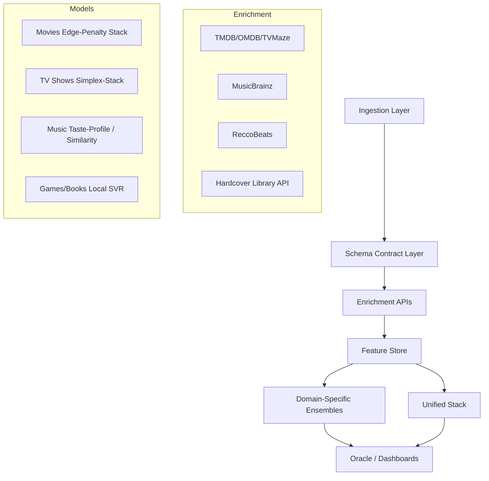

# Personal Media Intelligence Hub

## Table of Contents
- [Introduction](#introduction)
- [Architecture](#architecture)
- [Key Features](#key-features)
- [Engineering Highlights](#engineering-highlights)
- [Performance Benchmarks](#performance-benchmarks)
- [Technology Stack](#technology-stack)
- [Setup and Installation](#setup-and-installation)
- [Running the Project](#running-the-project)
- [Unified Media Intelligence](#unified-media-intelligence)
- [Dashboards & Visualizations](#dashboards--visualizations)
- [The Oracle (Explainable Recommendations)](#the-oracle-explainable-recommendations)
- [Repository Structure](#repository-structure)

## Introduction
The **Personal Media Intelligence Hub** is a sophisticated "Global Taste Engine" designed to map, analyze, and predict personal entertainment preferences across five distinct domains: Movies, TV Shows, Music, Games, and Books. By consolidating fragmented media consumption data and enriching it with high-fidelity metadata from external APIs, the system builds a unified semantic representation of "Taste" that allows for cross-domain discovery and explainable recommendations.

## Case Study: When fixing the evaluation made the numbers worse

A crucial part of this project involved recognizing and correcting inflated metrics in data-sparse domains (Games and Books, N ≈ 70–90). Initially, a single validation split suggested a promising R² of ~0.45. However, this was a statistical artifact. 

By migrating to a rigorous **10-fold × 5-repeat Cross-Validation** protocol, that inflated number deflated to a **modest and unstable** R². *Unstable* is the operative word: the two frozen-fold cells that once read Games 0.391 / Books 0.332 now read **Games 0.497 / Books 0.715** (2026-10-01 run), while the *unified* model's slice of those same items reads **0.359 / 0.388** — three different answers for one pair of domains, produced by adding a handful of rows and changing the estimator. That spread is itself the lesson: R² is not a reliable yardstick at N ≈ 70–100. This was a critical finding:
1.  **Metric Treachery:** In domains where ratings cluster tightly (e.g., 3.0 to 4.5), variance is tiny, so R² becomes hypersensitive to a few noisy items — swinging from ~0.36 to near-zero depending on the estimator — even when the Mean Absolute Error (MAE) is stable and genuinely useful.
2.  **The Distillation Prior — tested and dropped (both cells still null):** We hypothesized the unified model could anchor these sparse domains as a prior feature. On the current corpus (2026-10-01 run) the paired Wilcoxon ablation is null in both: **Games p = 0.317** (MAE 0.5894 → 0.5818) and **Books p = 0.465** (MAE 0.3491 → 0.3527). The Games move runs *in the prior's favour* and the Books move now runs *against* it; neither is anywhere near significance — the sign has flipped between corpus refreshes while the p-value never came close, which is what an underpowered test looks like from the outside. The verdict stays **DROP**. The Books cell has now read p = 0.71, then 0.034 ("KEEP"), then 0.446, then 0.336, then 0.248, now 0.465 across six refreshes; that is the reason it was never trusted. What *did* emerge without the prior are strong **skill scores** for the deployed local models (Games 0.376, Books 0.566, from `reports/baseline_sanity.json`) — they comfortably beat the mean-rating baseline.
3.  **The Pivot to Skill Score:** We reframed the evaluation metric from R² to **Skill Score** (`1 - MAE_model / MAE_baseline`), focusing on whether the system adds value over a simple historical average. Skill is the primary metric everywhere in this document because ratings cluster in 3–4★: a constant 3.5★ prediction already scores MAE 0.749 on the films and lands within ±0.5★ of the truth 61.9% of the time, so MAE and ±0.5★ accuracy look respectable for a model that learned nothing, while skill is 0 for predict-the-mean and ≈0 for any other constant. MAE and R² are reported alongside, as secondary numbers. 
4.  **Uncertainty & Acquisition:** We shifted the focus for these domains from raw accuracy to active learning. By surfacing **split-conformal prediction intervals** (e.g., "3.5 ± 1.3"), the Oracle now explicitly quantifies its uncertainty, guiding the user to deliberately rate the most informative backlog items to efficiently bridge the data gap.
5.  **Ablation Discipline:** We explicitly tested residual-head domain correction and Ridge-based stacking using paired Wilcoxon tests. Both were found to be actively destructive (destroying ~0.09 R²), leading to their removal in favor of a simpler, more robust Mean Ensemble.

Reviewers see inflated metrics daily; accurately deflating them and extracting a robust path forward demonstrates true ML maturity.

## Case Study: Does taste transfer across domains?

The project's central question. Two sub-stories:

**1. Two measurement bugs, two flipped conclusions.** The benchmark table once published the *unified model's per-domain OOF slice* as if it were the standalone local models — with N inflated 5× (OOF rows counted as items) and the local-model names glued on top. Repairing the writer (`assert benchmarks != slices`, per-item dedup, `assert N == n_unique_items`) forced standalone and unified to be measured with the **same estimator on the same folds**. But a second, subtler bug remained: the "local" benchmarks were *weakened proxies* (Movies = a plain 200-tree XGB, not the deployed tuned edge-penalty stacking ensemble), which flattered the unified model. Replacing the proxies with the **production local models** (measured honestly as 50-fold registry OOF) gives the comparison below. In the 2026-10-01 run the **local model wins all four domains**. One run earlier it was **split**: the unified slice narrowly won Movies (0.475 vs 0.486 MAE) and TV (0.666 vs 0.680), and the local models won Games and Books.

| Domain | Local skill | Unified slice skill | Local MAE | Unified slice MAE | Winner |
| :--- | ---: | ---: | ---: | ---: | :--- |
| Movies (N=1,163) | **0.355** | 0.315 | **0.483** | 0.513 | local, by 0.030 MAE |
| TV (N=175) | **0.208** | 0.186 | **0.694** | 0.714 | local, by 0.020 MAE — inside TV's fold-reshuffle noise (~0.02 MAE) |
| Games (N=66) | **0.376** | 0.202 | **0.515** | 0.659 | local, by a wide margin |
| Books (N=110) | **0.566** | 0.241 | **0.286** | 0.500 | local, by a wide margin (R² 0.715 vs 0.388, ±0.5★ accuracy 88.2% vs 75.5%) |

*Skill = 1 − MAE / MAE(predict-the-mean), both columns scored against the same per-domain mean baseline from `reports/baseline_sanity.json`.*

**The caveat.** Every unified number in this table — and everywhere else in this document — is **optimistic by an unmeasured amount**, because `oof_entity_encode` builds the entity target encodings on its own internal KFold that has nothing to do with the frozen registry. 48% of train rows carry a `creator_encoded` value computed from a test row's target, and the value is computed once and reused across all 50 folds. That is not fixed. The leak flatters the unified side, so it makes the local wins *conservative*: the local models win Movies by 0.030 and TV by 0.020 against an opponent that is being flattered, and Games and Books by 0.14 and 0.21. The previous run's two unified "wins" (margins 0.011 and 0.014) were smaller than that leak, and no claim was made from them.

The Games row is the first one measured honestly on **the same items on both sides**: six "Incomplete" games carried a fill-in `target_reg` of 0.0★ and trained in all 50 folds, so the unified game slice was N=72 against the standalone SVR's N=66 while the renderer printed "both measured … on the same items". Both are N=66 now.

The earlier claim that "pooling rescues the data-poor domain" is still **gone** *for the deployed unified model* — its Games and Books slices remain worse than the standalone models. That is not in tension with the transfer grid below, which measures a different thing: the unified model **includes** the thin domain in training and inherits its noise, whereas a zero-shot transfer model **excludes** it entirely and applies a function fitted on 1,062 films (the transfer grid was last run on the 2026-08-30 corpus and was not re-run on 2026-10-01). Pooling a noisy domain in hurts it; borrowing a clean domain's structure instead helps it. The deployed system keeps **local models for production scoring** and uses the unified model for the transfer study. Two measurement bugs, each of which *changed the scientific conclusion* — exactly why the single-source-of-truth renderer exists.

**2. The pre-registered transfer grid.** We then asked the sharper question — not "does the pooled model win on average" but *which specific source-domain combinations* transfer into which targets, zero-shot and augmented, in the shared feature space. The decision rules were **pre-registered before any result was seen** (positive finding ⇔ augmented lift > 0, paired p < 0.05, at ≥ 2 target fractions). <!-- TRANSFER_VERDICT:BEGIN -->
**Realized verdict (full 50-fold grid, domain-blind, quadruple-controlled): TASTE TRANSFERS.** TASTE TRANSFERS: at least one target shows a positive transfer finding (augmented lift > 0, paired p < 0.05, at >= 2 fractions).

| Target | Best source subset | lift @100% | p | Clears the bar? |
| :--- | :--- | ---: | ---: | :--- |
| movie | `book` | +0.0018 | 0.555 | no |
| tv | `book` | +0.0265 | 0.021 | no |
| game | `movie` | +0.1452 | 0.000 | YES |
| book | `tv+game` | +0.0220 | 0.244 | no |

**Zero-shot -- can other domains rank a target the model has never trained on?** (Spearman, mean over folds)

| Target | Target-only XGB (same shared features) | Deployed model | Best source (never sees target) | rho | % of target-only XGB |
| :--- | ---: | ---: | :--- | ---: | ---: |
| movie | 0.677 | 0.751 | `tv+game+book` | +0.490 | 72% |
| tv | 0.426 | 0.574 | `movie` | +0.524 | **123%** |
| game | 0.307 | 0.719 | `movie` | +0.599 | **195%** |
| book | 0.635 | 0.859 | `movie+tv` | +0.600 | 95% |

Bold rows are targets where a model that has **never seen the domain** ranks it better than a target-only XGB on the same shared features: `movie->tv`, `movie->game`. Against the deployed model (pooled per-item Spearman from `baseline_sanity.json`, a different estimator than the per-fold mean) it wins for none of them.

**Why the sign differs by domain.** Local rating coherence -- how well an item's rating is predicted by its nearest neighbour in the shared text space -- orders the domains identically to the value of their own training data:

| Domain | n | Coherence (rho) | p | Effect of its own data on a movie-trained model |
| :--- | ---: | ---: | ---: | :--- |
| tv | 175 | +0.102 | 0.1805 | hurts |
| movie | 1062 | +0.245 | 0.0000 | n/a (is the source) |
| game | 66 | +0.361 | 0.0029 | null |
| book | 104 | +0.716 | 0.0000 | helps |

TV is the only domain where the mean gap to the nearest neighbour (1.097) EXCEEDS the spread of its own ratings (1.071) -- copying a lookalike is worse than guessing the average. Boosting still fits those rows; with no local structure to fit it fits noise, into exactly the region where the TV test items live.

Aligned-space distance still does not predict transfer (Spearman +0.191 over n=12 pairs).
<!-- TRANSFER_VERDICT:END --> Pre-registering the rule *before* running is what makes this reportable — and what makes its limits visible. The rule scores **augmented lift in MAE-skill**, and on that rule only Games clears the bar. But the largest effect in this grid is one the rule cannot see at all: a model trained on movies alone ranks TV and Games better than a target-only XGB on the same shared features does (the deployed TV and Games models, built on richer local features, still rank better; see the Deployed model column). MAE-skill misses it because the rating distribution is too concentrated for MAE to separate any model from a constant — 62% of films sit in three adjacent half-star bins, where a flat 3.5★ already scores MAE 0.759 and lands within ±0.5★ of the truth 61.6% of the time. The fixed rule is reported unchanged above; the zero-shot table beside it reports what the rule was never measuring. Changing the metric after seeing the data would not be legitimate, so both are shown, and the pre-registered verdict is not restated as the headline.

<!-- TRANSFER_GRID_FULL:BEGIN -->
## Target: Movies (107 held-out items per fold)

A target-only XGB on the same shared features (not the deployed model) scores **0.677** (SE 0.008). Bold = above that point estimate (no significance test).

| Source domains | 0% (zero-shot) | 25% | 50% | 100% |
| :--- | ---: | ---: | ---: | ---: |
| `tv+game+book` | +0.490 | +0.631 | +0.653 | **+0.683** |
| `tv` | +0.430 | +0.624 | +0.650 | **+0.680** |
| `tv+book` | +0.420 | +0.637 | +0.656 | +0.677 |
| `tv+game` | +0.373 | +0.621 | +0.649 | +0.674 |
| `game+book` | +0.320 | +0.626 | +0.650 | +0.676 |
| `book` | +0.137 | +0.628 | +0.658 | **+0.685** |
| `game` | +0.091 | +0.617 | +0.648 | **+0.677** |

## Target: TV (18 held-out items per fold)

A target-only XGB on the same shared features (not the deployed model) scores **0.426** (SE 0.029). Bold = above that point estimate (no significance test).

| Source domains | 0% (zero-shot) | 25% | 50% | 100% |
| :--- | ---: | ---: | ---: | ---: |
| `movie` | **+0.524** | **+0.433** | +0.424 | **+0.465** |
| `movie+game+book` | **+0.471** | **+0.433** | **+0.464** | **+0.493** |
| `movie+book` | **+0.453** | **+0.433** | **+0.470** | **+0.518** |
| `movie+game` | **+0.435** | **+0.468** | **+0.437** | **+0.493** |
| `game+book` | +0.331 | +0.322 | +0.367 | **+0.468** |
| `book` | +0.150 | +0.331 | +0.379 | **+0.483** |
| `game` | +0.149 | +0.246 | +0.316 | +0.419 |

## Target: Games (7 held-out items per fold)

A target-only XGB on the same shared features (not the deployed model) scores **0.307** (SE 0.059). Bold = above that point estimate (no significance test).

| Source domains | 0% (zero-shot) | 25% | 50% | 100% |
| :--- | ---: | ---: | ---: | ---: |
| `movie` | **+0.599** | **+0.586** | **+0.612** | **+0.602** |
| `movie+book` | **+0.584** | **+0.591** | **+0.601** | **+0.619** |
| `movie+tv` | **+0.541** | **+0.543** | **+0.569** | **+0.538** |
| `movie+tv+book` | **+0.508** | **+0.551** | **+0.535** | **+0.554** |
| `tv+book` | **+0.468** | **+0.474** | **+0.481** | **+0.507** |
| `tv` | **+0.404** | **+0.431** | **+0.487** | **+0.551** |
| `book` | **+0.333** | **+0.426** | **+0.442** | **+0.490** |

## Target: Books (11 held-out items per fold)

A target-only XGB on the same shared features (not the deployed model) scores **0.635** (SE 0.029). Bold = above that point estimate (no significance test).

| Source domains | 0% (zero-shot) | 25% | 50% | 100% |
| :--- | ---: | ---: | ---: | ---: |
| `movie+tv` | +0.600 | +0.626 | **+0.642** | **+0.676** |
| `movie+tv+game` | +0.575 | +0.621 | **+0.658** | **+0.689** |
| `movie` | +0.570 | +0.617 | **+0.649** | **+0.684** |
| `movie+game` | +0.562 | **+0.636** | **+0.653** | **+0.683** |
| `tv` | +0.514 | +0.550 | +0.629 | +0.628 |
| `tv+game` | +0.510 | +0.576 | +0.612 | **+0.655** |
| `game` | +0.223 | +0.481 | +0.578 | **+0.636** |
<!-- TRANSFER_GRID_FULL:END -->

## Case Study: The bugs no metric could see

Every bug below was silent. None of them moved an offline score when it was introduced, because the score was computed on the same corrupted frame the model trained on — the error sat on both sides of the split, identically. They were found by auditing the frames on disk against their sources, not by watching a number go down. `scripts/data_sanity_check.py` now runs those audits as a **gate** (row-count agreement across enriched → training → unified, persisted imputation, parse health *after* the pipeline's own cleaner, mojibake, rating-grid sanity, aligner presence; exit 1 on failure). It took the repo from **11 FAIL to 1**, and the survivor is the aligner check correctly refusing to score before the trainer has run.

| Fixed | Scope, measured |
| :--- | :--- |
| **`categorize_rating` drifted into three copies** | Two of them tested `if 'R' in r`, which reads `Not Rated` (123 films), `Unrated` (5) and `Approved` (4) as **Adult**. **132 of 453** `rated_Adult` films — 12.4% of the movie library — were in the wrong bucket. One canonical implementation now lives in `src/common/parsing.py`, checked against all 22 values the column actually holds. |
| **`imdb_votes` never parsed** | OMDb returns Indian-grouped strings (`'7,13,701'`); 747 of 1062 contain a comma. A `dtype == 'object'` guard stopped firing under pandas' Arrow string dtype, so **756 rows were median-filled**. Distinct values **305 → 1051**; mean 148,566 → 382,697. |
| **`runtime` never parsed** | 95 OMDb `"87 min"` strings → NaN → median 116. Parseable **967 → 1062**. |
| **`rotten_tomatoes_rating` never parsed** | Stored as `"92%"`; the same dead dtype guard crashed the movie feature build outright under this pandas version. **949** real RT scores now survive. |
| **`"Tagline: nan."` in the embedding** | `str(float('nan')) == 'nan'` and NaN is not None, so **121 of 1062** movie embedding bodies contained the literal token `nan`. **121 → 0.** |
| **Language one-hot split in two** | The column mixes ISO codes with English names, so `lang_en` (839) and `lang_English` (23) were two orthogonal one-hots for one language, and Japanese — split 25/6 — never reached the top-3 cut. A `norm_language` step moves the movie top-3 from `['en','hi','English']` to `['English','Hindi','Japanese']`. |
| **Games mojibake** | **40 of 72** rows carried double-encoded UTF-8 in `description_raw` — which *is* the entire embedding body for games — plus `God of War: Ragnarök` in the title. Cause: `except: → latin1` CSV fallbacks that re-encode one level deeper on every read, never repaired because enrichment only refills *empty* cells. **44 corrupt cells → 0**, and `read_media_csv` now repairs on fallback instead of propagating. |
| **Unrated games trained as 0.0★** | Six "Incomplete" games carried `target_reg = 0.0` — a `fillna`, not a NaN — off the bottom of the 0.5–5.0 grid, in all 50 folds. Now filtered in the fold registry, the trainer and the evaluator. Measured on the previous OOF: headline MAE 0.5153 → 0.5029, game slice **0.8681 → 0.6364**. |
| **The unified batch scorer built the wrong matrix** | `predict_unified_ratings.py` — the path behind the app's unified predictions — did not build the entity or country blocks at all. `creator_encoded`/`studio_encoded` sit on a ~3.3★ scale and are never 0 in any training row, so zero-filling them served the model a row far outside its training distribution: **mean \|Δpred\| 0.52★, max 1.83★** on the deployed XGB. Same file: `tags` was never populated (173/173 TV rows and 71/104 books embedded as `"Tags: ."`), no DomainAligner was applied, genre one-hots were built without `canon_genre` (115 rows lost bits), and a stale `categorize_rating` put 151 rows (10.7%) in the wrong bucket. It now scores every row through the Oracle's own `transform_single_media` and **raises** on any unbuilt column (2026-10-11). |
| **`resolve_qid` guessed** | The old version fell back to `cands[0]` whenever nothing matched the type hint — returning *Batman Province, Turkey* for the film **Batman**, the 1984 *song* for **Ghostbusters**, a 1986 *video game* for **Top Gun**, and the *franchise* entity for **Toy Story**. It now searches 20 candidates (the film is not in the top 5 for "Batman"), type-matches positionally, rejects franchise/song phrases, disambiguates on year, and returns **`None`** rather than guessing. QID resolution **96.8% → 92.6%** — the drop is the point, and `entity_links.csv` is rebuilt on the new QIDs. |
| **Two pipeline steps that existed but never ran** | `predict_unified_ratings` was not in the plan at all: the predictions file on disk was two months older than the features, which is why the games/books distillation prior silently never attached. And the four diagnostics (`feature_diagnostics`, `classification_diagnostics`, `baseline_sanity`, `bias_variance`) were *read* by `render_docs` but *produced* by nothing — so this README was republishing SHAP tables and confusion matrices from an older library next to freshly computed benchmarks, with nothing marking them as different runs. Both are now in `run_pipeline.py`, ordered around a third trap: `build_universal_dataset` rewrites the preprocessor state **without** the `aligner` key and only the trainer puts it back, so any feature rebuild without a retrain silently drops CORAL alignment (tv 0.071, book 0.127, game 0.150 mean \|Δpred\|; movie exactly 0, because it is the reference domain — which is why it stayed hidden). |
| **The movie embedding header ate the whole token budget** | `_movie_header` prefixed the **full billed cast** (median **41** names, max 331) to every chunk-pooled window, so the header alone ran a median **230 of MiniLM's 256 tokens**: **42.7%** of films overflowed on the header *alone* and never had their plot read, and **69.0%** of header+window strings were truncated. Capping the people lists (6 actors / 3 directors / 3 writers / 5 genres) took those to **0.0%** and **0.1%** — and moved movie MAE **0.4925 → 0.4863** (R² 0.5133 → 0.5226) on the identical 1,062 films. Chunk-pooling had been a no-op for the largest domain until this. |
| **The unified language axis and the TV country axis were each split in two** | `unified_feature_engineering.py` never called `norm_language`, so `lang_en` (983 rows) and `lang_English` (145) were two orthogonal one-hots for one language; the shows matrix carried the same split as `ctry_US` (5) against `ctry_United States` (116). Both are normalized now — one `ctry_United States` column at **121** shows, and South Korea enters the top-8. The cost, stated plainly: **+0.0046 unified MAE** (0.4979 → 0.5025 on identical items), because the split was a partial **domain indicator** — `lang_en` held movies and TV (TMDB ISO codes), `lang_English` held mostly books (OMDb/Hardcover names) — and a model whose thesis is cross-domain generalisation was reading domain identity off a feature meant to bridge domains. A confound removed, not a regression. |
| **`models/books/text_knn.joblib` was never rebuilt by the pipeline** | The Books Oracle's text-kNN was written by hand and nothing regenerated it, so it served from a PCA space fitted on an older corpus and an older text recipe. It is a pipeline step now, rebuilt every run: **skill 0.507, MAE 0.327**. The same pass fixed the bias/variance harness, which now scores the unified row on the **1,407** rated items rather than all 1,413. |

**What it bought, honestly: one attributable win, and the rest flat.** The genuinely like-for-like movie comparison — the same 1,062 films throughout — separates the two kinds of change. The five *parsing* fixes on their own were flat: MAE **0.4920 → 0.4925**, R² 0.5201 → 0.5133. The features became *correct*; the model did not become *better*. That is a real result and it is worth stating plainly: several repaired columns (`rated_*`, the language one-hots) are low-weight for this model, and the columns that carry the weight (`critic_avg_5`, `imdb_rating`) were never broken.

The **movie header cap is the exception — the one change this run with a clean, attributable win.** On the same 1,062 films it moves MAE **0.4925 → 0.4863** and R² 0.5133 → **0.5226**, and the mechanism is measured rather than inferred: `_movie_header` embedded the **full billed cast** (median 41 names, max 331) and repeated it on every window, so the header alone ran a median **230 tokens** against MiniLM's 256-token cap — **42.7% of films overflowed on the header alone and never had their plot read at all**, and **69.0%** of header+window strings were truncated. Capping the people lists (6 actors / 3 directors / 3 writers / 5 genres) took those to **0.0%** and **0.1%**. Chunk-pooling had been a **no-op for the largest domain** until this.

Games is the other like-for-like slice — the same 66 items — and it moves 0.5152 → **0.5303**, i.e. slightly *worse*, which at N=66 is well inside noise in either direction.

The headline unified row moved further (MAE 0.5313 → 0.5025, R² 0.4679 → 0.5202) but **that is not a controlled comparison and should not be read as a win.** N is 1,407 on both sides by coincidence, not by construction: the six zero-target games left the registry while two shows and four books arrived. Part of the move is separately measured — dropping the zero-target games alone was 0.5153 → 0.5029 on the old OOF — and the remainder is confounded with a changed item set. Pushing the other way inside this run, normalising the unified language axis cost **+0.0046 MAE** on identical items — see the language/country row above.

**Still open**, because a data-integrity section that lists only wins is not one:
- **Entity-encoding leakage across the fold boundary.** `oof_entity_encode` runs its own internal KFold, unrelated to the frozen registry: **48% of train rows** have `creator_encoded` computed from a test row's target. `comprehensive_evaluator.py` now re-encodes creator/studio inside each registry fold from training rows only, but that path activates only after the next unified feature rebuild (it needs `state['entity_raw']`). **Until that rebuild, every unified MAE/R² reported here is optimistic by an unmeasured amount.**
- FIXED 2026-10-11: `movies/predict_ratings.py` used to zero-fill 23 of its 107 features. It now builds every row with `transform_single_movie`, the same path the Movies Oracle uses.
- FIXED 2026-10-11: the dead distillation lookup (`pred_Stacking`) was deleted from the games and books trainers; the prior stays dropped on the ablation evidence.
- FIXED 2026-10-11: `render_docs` captions now compute their numbers and direction words from the JSON they sit beside (guarded by `tests/test_render_docs_provenance.py`).

## Architecture



## Dataset Schemas

The system orchestrates a multi-domain data lake with strictly enforced schema contracts. Every domain moves through **two schema layers**, and both are documented below because they answer different questions:

1. **Ingested schema** — the raw fields each external API returns, persisted to `data/processed/<domain>/enriched_data.csv`. This is what is *collected*.
2. **Training schema** — the engineered numeric feature matrix actually fed to the models, persisted to `data/processed/<domain>/training_features.csv` (and `…/unified/training_features.csv`). This is what is *learned from*.

The per-domain models train on their own engineered matrix; the **Unified Model** re-projects every domain into a single **239-feature** shared latent space (vibe PCA aligned via CORAL). Column counts below are the live widths of the on-disk training matrices (verified 2026-08-28 against `data/processed/*/training_features.csv`; earlier drafts quoted stale design-time widths). The current library (2026-10-01 run) is **1,163 movies · 175 TV shows · 72 games (66 rated) · 110 books = 1,520 rows**, of which the frozen fold registry covers the **1,514 rated** items.

> **Convention.** `target_reg` is the 0.5★-grid user rating (the regression label); `target_ordinal` is its 10-bucket integer encoding (0.5★→0 … 5.0★→9); `target_class` is a coarse low/med/high bin kept for legacy dashboards. These label columns are excluded from every feature count quoted below.

### 🎬 Movies (TMDB + OMDb)
**Ingested** (`enriched_data.csv`, 36 raw fields): `tmdb_id, imdb_id, letterboxd_name/uri, year, title, rated, released, runtime, genre, director, writer, actors, plot, overview, tagline, language, country, awards, imdb_rating, imdb_votes, metascore, rotten_tomatoes_rating, box_office, production, popularity, vote_average, vote_count, user_rating, is_liked, …` (+ poster/backdrop art, processing status).

**Training** (`training_features.csv`, **107 features**):
| Category | Engineered features |
| :--- | :--- |
| **Numerical (17)** | Year, Runtime, IMDb Rating, IMDb Votes, Metascore, RT%, `box_office_log`/`budget_log`/`revenue_log`/`vote_count_log` (log1p), Popularity, Vote Average, Awards `total_wins`/`total_nominations` (regex-parsed), `critic_avg_5` (blended IMDb/Metascore/RT/TMDB on a 5★ scale), `rel_month`, `age_at_rating` |
| **Categorical (29)** | Language one-hot (4: `lang_English/Hindi/Japanese/Other`, from the normalized language field), Genres multi-hot (22, `MultiLabelBinarizer`), MPAA bucket (3: `rated_Adult/Teen/General`) |
| **Relational (17)** | Leakage-safe **target encodings** — Director, Actors, Writer, Composer, Cinematographer, Editor, Producer, Production, Director×Genre — Bayesian-smoothed (**m=2**, swept on inner OOF: m=2 → 0.4694 MAE vs m=10 → 0.4802, because the median crew entity here has 1–2 credits and a heavy prior just re-prints the global mean) over out-of-fold splits, each (except `dir_genre`) paired with its `*_n` credit count |
| **Neighbours (4)** | `nb_similar_mean`/`_n`, `nb_recommendations_mean`/`_n` — the mean rating of the already-rated titles among a film's TMDB `similar`/`recommendations` lists |
| **Vibe (NLP, 40)** | 384-d MiniLM-L6-v2 embedding of *Title + Director + Cast + Genre + Tagline + Plot + Overview*, sentence-windowed and mean-pooled → **40 PCA components** |

### 📺 TV Shows (TMDB + TVMaze + OMDb)
**Ingested** (`enriched_data.csv`, 35 raw fields): `tmdb_id, tvmaze_id, name, year, overview, tagline, created_by, genres, vote_average, vote_count, imdb_rating, imdb_votes, number_of_episodes, number_of_seasons, status, network, language, runtime, first_air_date, last_air_date, age_rating, awards, actors, writer, country, production_companies, user_rating, watch_count, …`.

**Training** (`training_features.csv`, **56 features**):
| Category | Engineered features |
| :--- | :--- |
| **Numerical (11)** | Year, Vote Average, IMDb Rating, `vote_count_log`/`imdb_votes_log` (log1p), Season Count, Episode Count, Runtime, `is_adult`, Awards `total_wins`/`total_nominations` |
| **Categorical (27)** | Network one-hot (11: top-10 + Other, `net_`), Genres multi-hot (7, frequency-gated at ≥5% of N, `g_`), Country one-hot (9, `ctry_`) |
| **Relational (3)** | Leakage-safe target encodings — Creator, Actors, Writer (same OOF recipe as Movies, but **m=10**: the light prior does *not* transfer to a 175-row domain where most creators have a single credit, so it would leave the encoding sitting on one other show's rating) |
| **Vibe (NLP, 15)** | 384-d MiniLM-L6-v2 embedding of *Title + Network + Overview + the season-by-season narrative* (see [Text representation](#text-representation--chunk-pooled-and-now-on-every-path)) → **15 PCA components** |

### 🎮 Games (RAWG)
**Ingested** (`enriched_data.csv`, 16 raw fields): `name, my_rating, platform_from_text, released, age_rating, genres, developers, publishers, metacritic, rating, ratings_count, reviews_count, tags, description_raw, playtime, cover`. Ratings include the sentinel **`'I'` (Incomplete)** → mapped to NaN (kept for ranking, excluded from supervised scoring).

**Training** (`training_features.csv`, **51 features**):
| Category | Engineered features |
| :--- | :--- |
| **Numerical (6)** | Year, Metacritic, Global Rating, Ratings Count, Reviews Count, Playtime |
| **Categorical (22)** | Platform one-hot (4, `plat_`), Genres multi-hot (18, `gen_`) |
| **Relational (8)** | Leakage-safe target encodings (m=2) — Developers, Publishers, Tags, Genres — each with its `*_n` support count. These **replaced the old 17-column `dev_*` multi-hot**, which was variance rather than signal on 66 rated games and left `publishers` (49 distinct), `tags` (90% coverage) and `playtime` unread entirely. |
| **Vibe (NLP, 15)** | 384-d MiniLM-L6-v2 embedding of *Name + Genres + Tags + Description*, sentence-windowed and mean-pooled → **15 PCA components** (`min(15, N−1)`) |

### 📚 Books (Hardcover Library API)
**Ingested** (`enriched_data.csv`, 13 raw fields): `title, isbn, my_rating, authors, publisher, publishedDate, pageCount, categories, averageRating, ratingsCount, description, thumbnail, infoLink`. The dataset is pulled **entirely from the authenticated user's Hardcover library** (`user_books` with a rating) via the GraphQL API — title, rating, authors, genres, page count and description all come from one library record, so there is no `book.txt`/CSV input and no fuzzy title/ISBN join. (The Books *Oracle* still queries Open Library live for arbitrary unrated books.)

**Training** (`training_features.csv`, **29 features**):
| Category | Engineered features |
| :--- | :--- |
| **Numerical (4)** | Year, Page Count, Average Rating, Ratings Count |
| **Relational (10)** | Leakage-safe target encodings (m=2) — Authors, Categories, Publisher, **Moods**, **Hardcover tags** — each with its `*_n` support count. |
| **Vibe (NLP, 15)** | 384-d MiniLM-L6-v2 embedding of *Title + Authors + Categories + Description*, sentence-windowed and mean-pooled → up to **15 PCA components** (`min(15, N−1)`) |

> **Why Books shrank from 180 columns to 29.** The old matrix emitted 10 author dummies and 155 category dummies — **165 near-empty binary columns for ~100 rated books**, most with one or two positives, the worst feature-to-sample ratio in the project and pure variance. A smoothed mean rating per author/category carries the same information in one dense column each and lets the prior handle the long tail. The swap also picked up `moods` and `hc_tags` (65% / 69% coverage from Hardcover), which the multi-hot build never read at all. Books now has the **lowest** MAE and the **highest** R² of any domain here.

### 🎵 Music (Spotify + ReccoBeats + MusicBrainz + Genius)
Music has **no ground-truth star ratings, and we deliberately do not synthesize one** — a fabricated "affinity rating" was misleading, so it was removed. Music is instead handled as an **unsupervised taste engine**: the feature matrix (in `music_features.npz`, StandardScaler-normalized) is clustered into taste *personas* (KMeans) and queried by **song-to-song cosine similarity**, and a PU classifier (your library vs a background pool) scores how "you" a new track sounds. There is **no rating target and no rating model** (see [Music: Clustering & Similarity](#engineering-highlights)).

**Ingested**: Spotify library/playlists (`track_id, name, primary_artist, album, popularity, artist_followers, …`), ReccoBeats **9 audio features** (`acousticness, danceability, energy, instrumentalness, liveness, loudness, speechiness, tempo, valence`), MusicBrainz (`mb_genres, mb_tags, mb_length_ms`), Genius (`lyrics`, VADER sentiment).

**Training** (engineered matrix):
| Category | Engineered features |
| :--- | :--- |
| **Numerical** | Duration, Release Year, Track Age, Popularity, Artist Popularity/Followers (log), Album/Track position, Explicit |
| **Audio (ReccoBeats)** | The 9 audio features above, each median-imputed **+ a `_missing` flag** |
| **Lyrical** | Word/line counts, unique-word ratio, VADER sentiment (`pos/neu/neg/compound`), `lyrics_found` |
| **Categorical** | Genres/Tags multi-hot (top-60, `g_`), Artists multi-hot (top-40, `a_`) |
| **Vibe (NLP)** | MiniLM-L6-v2 embedding of *Name + Genres + MB-Tags + Lyric snippet* → **32 PCA components** (`emb_`) |

### 📺 YouTube (YouTube Data API v3)
Ingestion-only (no rating model). **Video:** Video ID, Duration, Tags, Description, Views, Likes, Comment Count. **Channel:** Channel ID, Title, Subscriber Count, Video Count.

### 🌐 Unified Schema (Cross-Domain, 239 features)
The Unified Model concatenates every domain into one row-space (`data/processed/unified/training_features.csv`, **244 columns = 239 features + 5 bookkeeping** [`target_reg, target_ordinal, rating_date, source_id, media_type`], 1,413 rows). Heterogeneous fields are mapped onto a common backbone:
- **Identity:** `is_tv_show/is_game/is_book/is_music` indicators + `has_{movie,tv,game,book,music}_feats` multi-modal missingness masks (so the model can tell an absent feature from a real zero).
- **Narrative:** A single **10-d PCA vibe space** over unified text (*Title + Lead + Overview*), with **CORAL/centroid alignment fit per training fold** (no leakage) so "vibe" geometry is comparable across domains.
- **Genre/Rating:** Cross-domain genre multi-hot (**183 `gen_` columns**, with `Sci-Fi & Fantasy`/`Action & Adventure` split into atomic genres), language one-hot (4), country one-hot (7), MPAA bucket (3). The genre block is wide because book subjects arrive from Hardcover unnormalized — `gen_Juvenile fiction` and `gen_Childrens fiction` are separate columns.
- **Entity:** `creator_encoded`/`studio_encoded` (+ their `*_n` supports) — one cross-domain director/developer/author channel and one studio/publisher/network channel.
- **Commercial:** Log-normalized Box Office / Popularity proxies.
- **Quality:** `critic_avg_5` — blended, scale-normalized average of IMDb, RT, Metascore, and RAWG/Google ratings.
- **Music affinity (7):** `music_affinity_c0…c4/max/mean` — cosine similarity of the item's text embedding to the music taste-profile centroids, **gated per target domain** by the measured transfer matrix (zeroed for domains where music lift is negative). These are *features on rated items*, not music rows.
- **Music is not pooled here:** because music has no rating target, music **rows** are **not** part of the unified rated model or benchmark — music lives in its own unsupervised taste-profile / similarity engine.

## Feature Engineering Deep-Dive

> This section explains, per domain, **how every pulled field becomes a model feature, what each feature contributes, and which features actually drive the predictions** (measured with SHAP, not assumed). All feature lists below are the *live on-disk columns* of `training_features.csv`; the SHAP and coverage numbers are generated by `python -m src.experiments.feature_diagnostics` (charts in `reports/shap_<domain>.png`).
>
> **The universal recipe** (every domain shares it): *numeric metadata* (cleaned, `log1p` on skewed money/counts) → *categoricals* multi/one-hot (frequency-gated to control width) or, in the small domains, *leakage-safe target encodings* → *text "vibe"* (title/genre header + description → `all-MiniLM-L6-v2` 384-d embedding, **sentence-windowed and mean-pooled** so nothing is truncated → PCA) → save a `joblib` **state** (medians, fitted PCA, fitted encoders, column list) so inference rebuilds the *identical* matrix (train-serve parity). The label is `target_reg` (0.5★ grid), with `target_ordinal` (10 buckets) and `target_class` (coarse) alongside.

### Text representation — chunk-pooled, and now on every path

`all-MiniLM-L6-v2` reads at most 256 tokens. The corpus does not respect that. Measured before the change: **game descriptions averaged 293 tokens with 48.6% of the library over the cap**, books 208 with 22.0% over — while movies and TV averaged 90 and never hit it. Truncation was therefore discarding roughly half the games corpus and none of the movies: a length confound falling entirely on the two smallest domains, inside the very shared space the transfer study measures. **The movies exemption was an illusion.** Their *body* text was short, but the header prefixed to every window carried the full billed cast, so the header alone spent a median 230 of the 256 tokens and 69.0% of movie strings were truncated regardless — pooling was a no-op for the largest domain until the header was capped.

`src/common/text_embedding.py::encode_pooled` splits a description on sentence boundaries into windows that fit the model, embeds each window **with the title/genre header attached** so a long blurb cannot drift off-item, then mean-pools and re-normalizes. Because every window vector is unit length, one window and eight land in the same space — items stay comparable *by construction* rather than by being cut to a common length. Head-to-head against the alternatives (5 seeds, text block alone, skill = 1 − MAE/MAE_mean; `src/experiments/text_norm_variants.py`):

| variant | book skill | movie→book | movie→game |
| :--- | ---: | ---: | ---: |
| `prefix40` (the old positional cut) | 0.045 ± .006 | 0.060 ± .001 | 0.002 ± .001 |
| stopwords removed | 0.057 ± .007 | 0.035 ± .002 | 0.005 ± .000 |
| tf-idf theme terms | 0.035 ± .004 | 0.012 ± .001 | −0.007 ± .001 |
| **chunk-pool mean (shipped)** | **0.098 ± .008** | **0.070 ± .002** | **0.007 ± .001** |

Books more than double and both cross-domain transfers improve. Keyword extraction is *worse*, not better: stripping a description to its most distinctive terms destroys the word order a sentence transformer encodes, and `movie→game` goes negative. Reading the whole text is what makes domains comparable, not compressing it. `encode_pooled` was previously wired into **2 of about 10 call sites**; it is now the only text path in the project — all four domains' feature engineering, all four `predict_ratings`, the unified builder and the unified scorer, both Oracles, and the active-learning queues.

**TV finally has something to read.** A TMDB show `overview` is the thinnest text in the project — a median of one sentence. `src/shows/season_data.py::season_overview_by_show` concatenates the per-season overviews **in season order** ("Season 1: … Season 2: …", capped at 12 seasons), which covers **119 of 175 shows (68%)** and takes TV's text from a median of **33 words to 109**, 1 sentence to 5, and **21% → 74%** of shows with at least three sentences. It is attached on all six show-text paths (feature engineering, batch scorer, AL queue, the TV Oracle's inference and similarity, the unified builder and scorer), because a caller that forgets to attach it degrades *silently* back to the one-line logline.

**What was deliberately not wired in.** `src/common/wikipedia_plots.py` pulls real beat-by-beat plot text through the MediaWiki API, and it works: **93.5% coverage on movies** (median 644 words, 32 sentences, 100% with ≥3 sentences), 65.3% on TV (median 108 — show articles carry short "Premise" sections), 54.2% on games, 49.0% on books. It was originally kept out of the feature pipeline on purpose. Partial coverage *inside* a domain is a register split — some films get encyclopedic prose and the rest keep a logline — and the asymmetry *across* domains is precisely the confound chunk-pooling was written to remove. **That changed in the 2026-10-01 run:** every domain's text body (and the unified builder's) now goes through `plot_for`, which substitutes the Wikipedia plot where one exists and falls back to the API blurb otherwise, so movie text now runs to ~5 embedding windows per film. The register-split concern above still applies to the items without an article. (The coverage percentages above are from the module's fetch report and were not re-measured on the 2026-10-01 corpus.)

### 🎬 Movies — 107 features
| Feature group | Fields & how they're used |
| :--- | :--- |
| **Critic numerics (17)** | `imdb_rating, metascore, rotten_tomatoes_rating, vote_average, imdb_votes, critic_avg_5` (scale-normalized blend of the four critic scores), `year, runtime, popularity, box_office_log, budget_log, revenue_log, vote_count_log` (log1p), `total_wins, total_nominations` (regex-parsed from the free-text awards string), `rel_month, age_at_rating`. |
| **Categorical (29)** | `lang_*` one-hot (top-3 + Other, now `English/Hindi/Japanese`), `gen_*` genre multi-hot (22, `MultiLabelBinarizer`), `rated_Adult/Teen/General` MPAA bucket. |
| **Vibe (40)** | `pca_0…39` — PCA of the chunk-pooled MiniLM embedding of *Title + Director + Cast + Genre + Tagline + Plot + Overview*. |
| **Target encodings (17)** | `director/actors/writer/composer/cinematographer/editor/producer/production/dir_genre_encoded` + `*_n` support counts — leakage-safe, Bayesian-smoothed (m=2), out-of-fold. **They are present in the persisted matrix** and the models do see them. |
| **Neighbours (4)** | `nb_similar_mean/_n`, `nb_recommendations_mean/_n` — the mean of your own ratings among a film's TMDB `similar`/`recommendations` neighbours. Deliberately **off for TV**, where 60% of shows have *zero* rated `similar` neighbours. |
| **What drives it (SHAP)** | `critic_avg_5` (0.261) and `imdb_rating` (0.178) dominate, then `vote_average` (0.062), `actors_encoded` (0.058), `age_at_rating` (0.044) (2026-10-01 run). **Movies are a critic-consensus model** — your taste tracks blended critic scores, plus a cast effect and a recency effect. |

> ✅ **Target-encoding caveat — closed.** An earlier revision of this README warned that the Director/Actor/Dir×Genre encodings were computed but never persisted, so no model saw them. That is no longer true: the live 107-column matrix contains nine entity encodings, and `actors_encoded` is the **fourth-strongest** movie feature by SHAP (0.058). The lever was real and it has been pulled — though see the leakage note in [the data-integrity case study](#case-study-the-bugs-no-metric-could-see): the *unified* model's entity encodings still cross the frozen-fold boundary.

### 📺 TV — 56 features
| Feature group | Fields & how they're used |
| :--- | :--- |
| **Numeric (11)** | `year, vote_average, imdb_rating, vote_count_log, imdb_votes_log` (log1p), `season_count, episode_count, runtime, is_adult, total_wins, total_nominations`. |
| **Categorical (27)** | `net_*` network one-hot (11, top-10 + Other), `g_*` genre multi-hot (7, gated at ≥5% of N), `ctry_*` country one-hot (9). |
| **Target encodings (3)** | `creator_encoded, actors_encoded, writer_encoded` — same OOF recipe as Movies at **m=10**. A prior sweep on 10 registry folds found *nothing* beats dropping the person encodings outright (m=2 → 0.7023, m=10 → 0.7168, OFF → 0.6792 MAE) with the whole spread inside TV's fold-reshuffle noise (~0.02 MAE), so this stays at the original value rather than chasing a winner out of noise. |
| **Vibe (15)** | `pca_0…14` — chunk-pooled MiniLM embedding of *Title + Network + Overview + season-by-season narrative*. |
| **What drives it (SHAP)** | `imdb_rating` (0.364) dominates everything — about four times the next feature (`imdb_votes_log`, 0.092), then `vote_average` (0.080), `pca_4` (0.064), `year` (0.059) (2026-10-01 run). TV is almost purely a **crowd-consensus** model, though a text component (`pca_4`) ranks fourth; on the 2026-08-28 corpus the season narrative had pushed `pca_1` into second place. The feature enrichment (creator/cast/writer encodings, multi-critic, country, awards) lifted TV off its old MAE 0.802 / R² 0.082 floor; it currently sits at **skill 0.208, Spearman 0.565** (MAE 0.694 / R² 0.271) on 175 shows (2026-10-01 run) — still the weakest domain. |

### 🎮 Games — 51 features
| Feature group | Fields & how they're used |
| :--- | :--- |
| **Numeric (6)** | `metacritic, rating` (RAWG global), `ratings_count, reviews_count, year, playtime`. |
| **Categorical (22)** | `plat_*` platform one-hot (4), `gen_*` genre multi-hot (18). |
| **Target encodings (8)** | `developers/publishers/tags/genres_encoded` + `*_n` — replacing the old 17-column `dev_*` multi-hot, which at 66 rated games was variance rather than signal and left `publishers`, `tags` and `playtime` unread. |
| **Vibe (15)** | `pca_0…14` — chunk-pooled MiniLM embedding of *Name + Genres + Tags + Description*. This is the domain the pooling matters most for: **48.6% of RAWG descriptions run past MiniLM's token cap**, and the descriptions were also the domain worst hit by the mojibake corruption (40 of 72 rows). |
| **What drives it (SHAP)** | `ratings_count` (0.268), `pca_1` (0.159), `rating` (0.110), `playtime` (0.091), `reviews_count` (0.063) (2026-10-01 run). **These RAWG community-signal columns are the entire reason Games needs a *local* model** — they live *outside* the shared cross-domain space, so the unified model can't see them. It is why the local Games model beats the unified slice by a wide margin (skill 0.376 vs 0.202; MAE 0.515 vs 0.659) on the same 66 items. |

### 📚 Books — 29 features *(feature-starvation fixed by the Hardcover library API, then the width cut back)*
| Feature group | Fields & how they're used |
| :--- | :--- |
| **Numeric (4)** | `year, pageCount, averageRating, ratingsCount`. |
| **Target encodings (10)** | `authors/categories/publisher/moods/hc_tags_encoded` + `*_n` — one dense smoothed mean-rating column each, replacing the 165 near-empty author/category dummies. |
| **Vibe (15)** | `pca_0…14` — chunk-pooled MiniLM embedding of *Title + Authors + Categories + Description* (22% of book blurbs ran past the token cap before pooling). |
| **What drives it (SHAP)** | Embedding-led: `pca_1` (0.227), `pca_5` (0.084) and `pca_2` (0.066) outrank `authors_encoded` (0.060) and `averageRating` (0.050) (2026-10-01 run). The books-only SVR's skill over the mean baseline is **+0.566** (Spearman 0.859, N=110, 2026-10-01 run), and the local model beats the unified slice on every metric — skill 0.566 vs 0.241, MAE 0.286 vs 0.500, R² 0.715 vs 0.388, ±0.5★ accuracy 88.2% vs 75.5%. It is the strongest model in the project, on the smallest local feature matrix. |

> ✅ **Books is no longer feature-starved — this was the documented "#1 accuracy lever," and migrating ingestion to the Hardcover *library* API closed it.** The old Open-Library-enriched file left Books with **zero** author/category multi-hots (sparse, non-standard subjects died at the ≥2 gate) and three **dead unified channels** (`critic_avg_5 = 0.00`, `runtime = 0.00`, `gen_* = 0.00`). Pulling each book straight from one Hardcover library record fixed both: in the *unified* space those three channels are now **fully populated** (`critic_avg_5 1.00`, `runtime 1.00`, `gen_* 1.00`), and locally the library record carries `moods` and `hc_tags` on top of authors, categories and publisher. The second move was to stop spending that richness on width: the 165 sparse dummies became 5 target encodings, and Books went from *matching* the unified slice to beating it — by 0.21 MAE in the 2026-10-01 run (0.286 vs 0.500).

### 🎵 Music — 173 features (unsupervised — no rating)
Music has no star ratings and **no synthesized rating target**. These features are unsupervised inputs to the taste engine: they're **clustered** into taste personas (KMeans) and compared **song-to-song by cosine similarity**, and feed a PU classifier (library vs background pool). The behavioral signals that a rating would have encoded (saved status, playlist membership, top-track rank, popularity) are kept as **raw features** instead of being collapsed into one fabricated star value. "Most predictive features" / SHAP and confusion matrices do **not** apply — there is nothing to predict.
| Feature group | Fields & how they're used |
| :--- | :--- |
| **Meta numerics** | `duration_min, release_year, track_age, popularity, artist_popularity, artist_followers_log, album_total_tracks, track_number, explicit`. |
| **Audio (ReccoBeats, 9×2)** | `acousticness, danceability, energy, instrumentalness, liveness, loudness, speechiness, tempo, valence` — each **median-imputed + a `_missing` flag** so the model distinguishes a real 0 from absent data. |
| **Lyrical** | VADER sentiment (`pos/neu/neg/compound`), word/line/unique-word counts, `lyrics_found`. |
| **Categorical** | `g_*` genres/tags multi-hot (top-60), `a_*` artists multi-hot (top-40). |
| **Vibe (32)** | `emb_0…31` — MiniLM embedding of *Name + Genres + MB-tags + Lyric snippet*. |

### 🌐 Unified cross-domain — 239 features
Every domain is re-projected onto one backbone so a single model can score anything:
- **Schema harmonization:** heterogeneous fields renamed onto a shared backbone (game `developers`→`director`, book `pageCount`→`runtime`, etc.).
- **Identity & missingness:** `is_{tv,game,book,music}` + `has_{domain}_feats` masks so the model can tell an absent feature from a real zero. *(These are deliberately dropped in the transfer grid — see below.)*
- **Shared vibe:** a single **10-d** PCA over unified text, **CORAL/centroid-aligned per training fold** so "vibe" geometry is comparable across domains (leakage-safe).
- **Shared genre / quality / commercial:** cross-domain `gen_*` multi-hot, `critic_avg_5` (scale-normalized IMDb/RT/Metascore/RAWG blend), `box_office_log`/`popularity`.
- **Coverage reality (regenerated 2026-08-28):** the shared channels are dense for **all four rated domains**. `critic_avg_5` is 0.994 (movies), 1.000 (TV), 0.958 (games), 1.000 (books); `year`, `runtime`, `popularity` and the genre channel are 1.000 everywhere. Only `box_office_log` stays movie-specific (0.892 movies, 0.000 elsewhere). The previously-dead Books channels are fully populated since Books moved to the Hardcover library API.
- **Fixed this run:** the unified builder now calls `norm_language` before one-hotting, so `lang_en` and `lang_English` are a single column instead of two orthogonal ones, and the shows country block's `ctry_US` and `ctry_United States` are merged into one 121-show column (South Korea now reaches the top-8). Merging the language axis cost **+0.0046 unified MAE**: the split had been acting as a partial domain indicator, so what was removed is a confound, not a feature.

### 🔀 Transfer-learning features
The transfer grid (`transfer_study.py`) operates in a **domain-blind** subset of the unified space: it keeps `pca_*` (CORAL-aligned), `gen_*`, `critic_avg_5`, `year`, `popularity`, and **deliberately drops** the `is_*`/`has_*_feats` identity columns — otherwise a "transfer" model could cheat by splitting on domain identity instead of learning shared content. Genres are capped to the top-40 most frequent. This is why **taste transfer is measured only on shared content** (vibe + genre + critic + year), and why Games — whose real signal is the *local* RAWG columns the shared space excludes — both transfers *in* well (its shared-space self-signal is weak) yet still needs its local model for production.

### Diagnostics summary (per-base-learner ablation)
Are the ensembles complementary, or is one member dead weight? (`python -m src.experiments.feature_diagnostics`, 50 frozen folds, all rows **uncalibrated**, skill = beats predict-the-mean. Regenerated 2026-10-01, as a scheduled pipeline step rather than by hand.)
| Domain | XGB alone | CatBoost alone | SVR alone | Mean blend | Simplex blend | Read |
| :--- | :--- | :--- | :--- | :--- | :--- | :--- |
| **Movies** | **0.414** | 0.395 | 0.382 | 0.411 | 0.410 | **No blend gain** — XGB alone tops both blends by 0.003–0.004, and all five sit inside 0.032 of each other. The ensemble is buying nothing on this corpus. |
| **TV** | 0.219 | 0.229 | 0.164 | **0.232** | 0.216 | **Marginal** — the mean blend beats the best member (CatBoost) by +0.003; the simplex blend sits *below* CatBoost alone. SVR-alone trails the best blend by 0.068. |

> 🔄 **Both rows have moved again (2026-10-01 run).** One refresh earlier the simplex blend topped both domains (Movies 0.401, TV 0.255, beating the best member by +0.002 and +0.013). On this corpus XGB alone tops the Movies blends, and in TV the mean blend edges out CatBoost while the simplex blend falls below it. Earlier still, the corpus put TV's SVR-alone (0.110) *ahead* of the blend (0.095), and an earlier revision of this README recommended replacing the TV stack with a plain SVR; the TV SVR is now the clearly **weakest** member, so **that recommendation stays withdrawn**. No movement here is large, which is the point: at this N neither the member-vs-blend nor the blend-vs-blend gap is stable enough to redesign an ensemble around, and the deployed stacks are left alone. *Blend ≥ best single member* held for several refreshes and broke for Movies in the 2026-10-01 run; what still survives every refresh is *SVR is the weakest member in both domains*.

## Key Features
- **Consolidated Library:** A single-pipeline architecture managing **1,514 rated items** across four domains — 1,163 movies · 175 TV shows · 66 rated games · 110 books — plus **3,837 music tracks**. The unified frame holds 1,520 rows; the extra six are unrated "Incomplete" games, which are now excluded from the frozen fold registry, the trainer and the evaluator instead of being trained as 0.0★.
- **Advanced ML Ensemble:** Combines XGBoost and CatBoost through a Simplex-constrained Mean Ensemble for robust cross-domain fusion.
- **Explainable Oracle:** Predicts star ratings and provides "Verdicts" based on SHAP waterfall explanations and semantic similarity.
- **Taste Diversity Analytics:** Tracks **Taste Entropy** (Shannon Diversity) and temporal drift across your library.
- **Multi-Modal Fusion:** Integrates acoustic features, episodic metadata, and plot vibes into a 239-feature shared latent space.

## Engineering Highlights

- **Domain Centroid Alignment (CORAL):** Corrects domain shift in the shared embedding space by centering embeddings per media type, ensuring that "vibes" are comparable across Movies, Games, and Books.
- **Frozen-Fold Evaluation Registry:** Uses a deterministic `fold_registry.json` to ensure all cross-validation experiments use identical splits, eliminating metric drift and enabling paired statistical testing. It now covers **1,514 rated items** and explicitly excludes the six unrated games that used to train as 0.0★.
- **One Text Recipe, Everywhere:** `src/common/text_embedding.py::encode_pooled` — sentence-windowed, mean-pooled, L2-normalized embeddings, so a 500-word game description and a one-line logline land in the same space without either being truncated. Every text path in the project now calls it (feature engineering, batch scoring, both Oracles, the unified builder and scorer, the active-learning queues), instead of three hand-copied variants of "take the first 40 words". See [Text representation](#text-representation--chunk-pooled-and-now-on-every-path).
- **Data-Integrity Gate:** `scripts/data_sanity_check.py` fails the build (exit 1) on row-count disagreement between the enriched, training and unified frames, on medians persisted back into source data, on values that still coerce to NaN *after* the pipeline's own cleaner, on double-encoded UTF-8, on ratings off the 0.5★ grid, and on a missing `DomainAligner`. Written after a run in which none of eleven real data defects moved a single offline metric — see [the case study](#case-study-the-bugs-no-metric-could-see).
- **Asymmetric Edge-Penalty Loss:** Custom XGBoost objective derived to penalize errors more heavily at the extremes (favorites and hard passes).
  $$L(e, r) = \frac{1}{2}e^2 \cdot \exp(\alpha_{hi} \cdot \max(0, r - 4.0) + \alpha_{lo} \cdot \max(0, 1.5 - r))$$
- **Joint Optuna Tuning:** Hyperparameters and asymmetric penalty coefficients are jointly optimized under **5×2 Repeated Cross-Validation**.
- **Rank/Quantile Calibration (the real fix for regression-to-the-mean):** An MAE-trained regressor on clustered ratings (62% of movies are 3–4★) learns to hug the mode and *never predicts 5★* — which quietly inflates ±0.5★ accuracy for free. We apply a leakage-safe, **monotone** post-hoc map: each prediction's *rank* (vs the training-fold predictions) is mapped onto the empirical rating distribution (`np.quantile(y_train, rank)`), so the output distribution *equals* the real rating curve by construction and the model recovers the full 0.5–5★ range. Because it's ranking-preserving, it helps in proportion to ranking quality (Spearman ρ) **and** to how badly the model compressed its range — two conditions, not one: a **net win for Games (ρ=0.71, MAE 0.652→0.598) and Books (ρ=0.70)** — which ranked well *and* compressed every prediction into [2,4] — a **deliberate accuracy-for-coverage trade for Movies** (ρ=0.74: +45 genuine 5★ predictions for ~4pts of ±0.5★ Acc, since its range was already spread), and **skipped for TV** (ρ=0.59 is still too weak — calibration stamps 5★ on the wrong shows and costs ~10 accuracy points). *Calibrate where the order is trustworthy and the range is squashed.* (Those ρ values are the pre-calibration ranking correlations measured on the corpus where each decision was taken; the post-calibration ρ of the currently deployed models is in the [baseline-sanity table](#is-the-model-cheating-beating-the-meanmedian) below, and the per-domain policy has not been re-derived since.)
- **Music: Clustering & Similarity (no rating):** Music is treated as an unsupervised taste engine, **not** a rating problem. The library is clustered into taste *personas* (KMeans, silhouette-selected k), new/candidate tracks are scored by **song-to-song cosine similarity** and by a **Positive-Unlabeled (PU) classifier** (your library = positives, a mined background pool = negatives, with hard-negative weighting). This answers "*which of my songs is this like, and does it fit my taste?*" — deliberately replacing the earlier synthesized "affinity star rating," which was misleading and has been removed.
- **Distillation Prior (tested, then removed):** We evaluated feeding the Unified Model's predictions into the Games/Books local SVRs as a prior feature. On the current corpus (2026-10-01 run) the paired Wilcoxon ablation is null for **both** domains (Games p = 0.317, MAE 0.5894 → 0.5818; Books p = 0.465, MAE 0.3491 → 0.3527). The prior stays **dropped**. The Books cell has now read p = 0.71, 0.034, 0.446, 0.336, 0.248 and 0.465 across six corpus refreshes, with the sign of the effect flipping — an unstable, underpowered test rather than a real effect. **Shipped behaviour:** the deployed trainers have no prior code path at all (the dead `pred_Stacking` lookup was deleted on 2026-10-11).
- **Temporal Taste Decay:** Implementation of floored exponential sample weighting ($w_i = \max(\exp(-\lambda \Delta t_i), w_{min})$). Tuning revealed preferences are remarkably stable over the library's horizon (half-life ≈ 4.4 years).

## Performance Benchmarks

**What changed in the 2026-10-01 run** (full write-up in [`reports/FINAL_ML_TECHNICAL_REPORT.md`](reports/FINAL_ML_TECHNICAL_REPORT.md#what-changed-in-the-2026-10-01-run)). The corpus grew by 101 films (Letterboxd export of 2026-10-01, 42 of them standup comedy specials), 17 books and 2 shows; movie plot text now uses full Wikipedia plots (~5 embedding windows per film); and the fold registry was regenerated. Skill (1 − MAE / MAE of predict-the-mean; 0 for predict-the-mean) is the primary metric, previous → now:

| Domain | N | Skill | MAE | Spearman ρ | ±0.5★ acc |
| :--- | :--- | :--- | :--- | :--- | :--- |
| Movies | 1,062 → 1,163 | 0.362 → 0.355 | 0.484 → 0.483 | 0.755 → 0.751 | 77.0% → 77.1% |
| TV | 173 → 175 | 0.258 → 0.208 | 0.656 → 0.694 | 0.583 → 0.565 | 63.6% → 60.6% |
| Games | 66 → 66 | 0.376 → 0.376 | 0.515 → 0.515 | 0.735 → 0.719 | 75.8% → 74.2% |
| Books | 93 → 110 | 0.504 → 0.566 | 0.328 → 0.286 | 0.844 → 0.859 | 88.2% → 88.2% |
| Unified | 1,400 → 1,514 | 0.329 → 0.287 | 0.526 → 0.542 | 0.694 → 0.674 | 75.7% → 73.1% |

On the same 1,062 films as before, movie skill is 0.362 — unchanged; the 101 new films score skill 0.44 on their own (the 42 standup specials 0.51), so the small overall movie dip comes from the new mix, not a worse model. The TV drop is partly fold-reshuffle noise (~0.02 MAE) from the regenerated registry. The local-vs-unified comparison flipped: the local model now beats the unified slice in all four domains (MAE Movies 0.483 vs 0.513, TV 0.694 vs 0.714, Games 0.515 vs 0.659, Books 0.286 vs 0.500), where the previous run had the unified slice narrowly ahead on Movies and TV.

<!-- BENCHMARKS:BEGIN -->
| Domain | N | Model | **Skill vs mean** | Spearman ρ | MAE | MAE (predict mean) | R² | ±0.5★ Acc (mode baseline) |
| :--- | :--- | :--- | :--- | :--- | :--- | :--- | :--- | :--- |
| **Movies** | 1,163 | Prod Mean-Ensemble (edge+Cat+SVR+Ord, residual) | **+0.355** | 0.751 | 0.483 | 0.749 | 0.531 | 77.4% (51%) |
| **Unified (rated)** | 1,514 | Mean Ensemble | **+0.303** | 0.679 | 0.530 | 0.761 | 0.460 | 73.4% (50%) |
| **TV Shows** | 175 | Prod Simplex-Stack (edge+Cat+SVR) | **+0.241** | 0.574 | 0.666 | 0.877 | 0.306 | 63.4% (47%) |
| **Games** | 66 | Local SVR | **+0.376** | 0.719 | 0.515 | 0.826 | 0.497 | 74.2% (47%) |
| **Books** | 110 | Local SVR | **+0.566** | 0.859 | 0.286 | 0.659 | 0.715 | 88.2% (56%) |

*Read **Skill vs mean** first: 1 − MAE ÷ MAE of always predicting the average rating. Ratings cluster in 3–4★, so a constant 3.5★ already earns a respectable MAE and ±0.5★ accuracy (the bracketed mode baseline is what predicting the single most common rating scores); skill is 0 for any constant predictor and 1 for a perfect one, so it is the number the clustering cannot inflate. **Spearman ρ** asks whether the model orders items correctly. The four domain rows are the **production local models** on the frozen registry folds (one row per item, N = unique items): **Movies and TV are the deployed tuned ensembles** (Optuna edge-penalty XGB + CatBoost + SVR + ordinal-EV, fused) and **Games and Books are the deployed SVR**. The **Unified (rated)** row (N=1,514) is the cross-domain Mean Ensemble over all four rated domains. Music is not scored here: it has no star ratings and is handled as an unsupervised taste-profile / similarity engine.*
<!-- BENCHMARKS:END -->

*Note: Metrics reflect robust 10-fold × 5-repeat cross-validation with frozen folds. All numbers render from `reports/latest_metrics.json` via `src/reporting/render_docs.py`; the raw terminal outputs of every pipeline run are captured in [`reports/PIPELINE_RUN_LOG.md`](reports/PIPELINE_RUN_LOG.md).*

## Most Predictive Features (per model)

Which engineered features actually move each model's prediction — measured with SHAP, not assumed. This is the compact cross-model view; the per-domain narrative (and the full field→feature mapping) is in the [Feature Engineering Deep-Dive](#feature-engineering-deep-dive) above.

<!-- FEATURE_IMPORTANCE:BEGIN -->
*Top features by mean |SHAP| on a per-model XGB surrogate trained on each model's own feature matrix (regenerate with `python -m src.experiments.feature_diagnostics`; per-model bar charts in `reports/shap_<model>.png`). Values are the average absolute impact on the predicted star rating.*

| Model | Most predictive features (mean \|SHAP\|, high → low) |
| :--- | :--- |
| **Movies (stacking ensemble)** | `critic_avg_5` (0.261), `imdb_rating` (0.178), `vote_average` (0.062), `actors_encoded` (0.058), `age_at_rating` (0.044) |
| **TV Shows (simplex-stack)** | `imdb_rating` (0.364), `imdb_votes_log` (0.092), `vote_average` (0.080), `pca_4` (0.064), `year` (0.059) |
| **Games (local SVR)** | `ratings_count` (0.268), `pca_1` (0.159), `rating` (0.110), `playtime` (0.091), `reviews_count` (0.063) |
| **Books (local SVR)** | `pca_1` (0.227), `pca_5` (0.084), `pca_2` (0.066), `authors_encoded` (0.060), `pca_3` (0.053) |
| **Unified (Mean Ensemble)** | `critic_avg_5` (0.426), `creator_encoded` (0.094), `emb_334` (0.022), `emb_192` (0.014), `emb_93` (0.014) |
<!-- FEATURE_IMPORTANCE:END -->

## Classification Performance (Confusion Matrices)

The regression models are *also* graded as taste **classifiers** — because "did it predict the right rating bucket?" is the decision a user feels. Every deployed model's cached cross-validation predictions are re-scored as a 3-class decision (**Dislike / Neutral / Like**) plus a binary **Like** (recommend/skip) call, with full precision / recall / F1 / accuracy and per-model confusion matrices.

<!-- CLASSIFICATION:BEGIN -->
*The same registry OOF predictions scored on the regression benchmark table, re-framed as a 3-class taste decision — **Dislike** (≤2.5★), **Neutral** (2.5–3.5★], **Like** (>3.5★) — plus a binary **Like** (≥3.5★, the recommend/skip decision). Predictions are snapped to the 0.5★ grid first. Regenerate with `python -m src.experiments.classification_diagnostics`; per-model heatmaps in `reports/confusion_<model>.png`. Music is excluded (no ground-truth rating).*

#### Headline classification scores (per deployed model)

| Model | N | Accuracy | Balanced acc. | Macro-F1 | Weighted-F1 | Cohen κ | Binary-Like F1 |
| :--- | :--- | :--- | :--- | :--- | :--- | :--- | :--- |
| **Movies** | 1,163 | 65.6% | 66.5% | 0.665 | 0.656 | 0.474 | 0.823 |
| **TV Shows** | 175 | 54.3% | 53.5% | 0.539 | 0.557 | 0.281 | 0.824 |
| **Games** | 66 | 62.1% | 56.1% | 0.569 | 0.634 | 0.354 | 0.880 |
| **Books** | 110 | 77.3% | 75.6% | 0.769 | 0.773 | 0.635 | 0.915 |
| **Unified** | 1,514 | 60.0% | 59.5% | 0.606 | 0.604 | 0.380 | 0.810 |

#### Confusion matrices & per-class scores

**Movies** · Prod Stacking (edge+Cat+SVR+Ord) · N=1163 · accuracy 65.6%

| Actual ↓ / Pred → | Dislike | Neutral | Like |
| :--- | :---: | :---: | :---: |
| **Dislike** | 203 | 68 | 10 |
| **Neutral** | 77 | 257 | 120 |
| **Like** | 3 | 122 | 303 |

| Class | Precision | Recall | F1 | Support |
| :--- | :--- | :--- | :--- | :--- |
| Dislike | 0.717 | 0.722 | 0.720 | 281 |
| Neutral | 0.575 | 0.566 | 0.571 | 454 |
| Like | 0.700 | 0.708 | 0.704 | 428 |
| **Like (≥3.5★, binary)** | 0.818 | 0.828 | 0.823 | 645 |

**TV Shows** · Prod Simplex-Stack (edge+Cat+SVR) · N=175 · accuracy 54.3%

| Actual ↓ / Pred → | Dislike | Neutral | Like |
| :--- | :---: | :---: | :---: |
| **Dislike** | 16 | 12 | 4 |
| **Neutral** | 11 | 30 | 13 |
| **Like** | 0 | 40 | 49 |

| Class | Precision | Recall | F1 | Support |
| :--- | :--- | :--- | :--- | :--- |
| Dislike | 0.593 | 0.500 | 0.542 | 32 |
| Neutral | 0.366 | 0.556 | 0.441 | 54 |
| Like | 0.742 | 0.551 | 0.632 | 89 |
| **Like (≥3.5★, binary)** | 0.758 | 0.901 | 0.824 | 101 |

**Games** · Local SVR · N=66 · accuracy 62.1%

| Actual ↓ / Pred → | Dislike | Neutral | Like |
| :--- | :---: | :---: | :---: |
| **Dislike** | 3 | 5 | 0 |
| **Neutral** | 2 | 13 | 5 |
| **Like** | 0 | 13 | 25 |

| Class | Precision | Recall | F1 | Support |
| :--- | :--- | :--- | :--- | :--- |
| Dislike | 0.600 | 0.375 | 0.462 | 8 |
| Neutral | 0.419 | 0.650 | 0.510 | 20 |
| Like | 0.833 | 0.658 | 0.735 | 38 |
| **Like (≥3.5★, binary)** | 0.800 | 0.978 | 0.880 | 45 |

**Books** · Local SVR · N=110 · accuracy 77.3%

| Actual ↓ / Pred → | Dislike | Neutral | Like |
| :--- | :---: | :---: | :---: |
| **Dislike** | 18 | 8 | 0 |
| **Neutral** | 6 | 43 | 3 |
| **Like** | 0 | 8 | 24 |

| Class | Precision | Recall | F1 | Support |
| :--- | :--- | :--- | :--- | :--- |
| Dislike | 0.750 | 0.692 | 0.720 | 26 |
| Neutral | 0.729 | 0.827 | 0.775 | 52 |
| Like | 0.889 | 0.750 | 0.814 | 32 |
| **Like (≥3.5★, binary)** | 0.936 | 0.894 | 0.915 | 66 |

**Unified** · Mean Ensemble (XGB+Cat) · N=1514 · accuracy 60.0%

| Actual ↓ / Pred → | Dislike | Neutral | Like |
| :--- | :---: | :---: | :---: |
| **Dislike** | 194 | 137 | 16 |
| **Neutral** | 82 | 355 | 143 |
| **Like** | 7 | 220 | 360 |

| Class | Precision | Recall | F1 | Support |
| :--- | :--- | :--- | :--- | :--- |
| Dislike | 0.685 | 0.559 | 0.616 | 347 |
| Neutral | 0.499 | 0.612 | 0.549 | 580 |
| Like | 0.694 | 0.613 | 0.651 | 587 |
| **Like (≥3.5★, binary)** | 0.765 | 0.860 | 0.810 | 857 |

<!-- CLASSIFICATION:END -->

## Is the Model Cheating? (Beating the Mean/Median)

A fair worry: in domains where ratings cluster tightly, a model that just predicts *near the mean* can post a good MAE and ±0.5★ accuracy without learning anything. So every deployed model is pitted against the trivial baselines — predict-the-mean, predict-the-median, predict-the-mode — and, most importantly, checked for whether it **orders** items correctly (Spearman ρ), which a mean-hugger mathematically cannot do.

<!-- BASELINE_SANITY:BEGIN -->
*The honest test of "did it learn taste, or is it just predicting near the mean/median?" MAE and ±0.5★ accuracy are gameable in clustered domains — so this table pits each deployed model against the trivial baselines. Regenerate with `python -m src.experiments.baseline_sanity`.*

| Model | N | MAE | MAE (mean) | Skill vs mean | ±0.5★ acc | ±0.5★ acc (mode) | Acc lift | **Spearman ρ** | p |
| :--- | :--- | :--- | :--- | :--- | :--- | :--- | :--- | :--- | :--- |
| **Movies** | 1,163 | 0.483 | 0.749 | +0.355 | 77% | 51% | +26% | **0.751** | 2e-211 |
| **TV Shows** | 175 | 0.666 | 0.877 | +0.241 | 63% | 47% | +17% | **0.574** | 1e-16 |
| **Games** | 66 | 0.515 | 0.826 | +0.376 | 74% | 47% | +27% | **0.719** | 1e-11 |
| **Books** | 110 | 0.286 | 0.659 | +0.566 | 88% | 56% | +33% | **0.859** | 3e-33 |
| **Unified** | 1,514 | 0.530 | 0.761 | +0.303 | 73% | 50% | +23% | **0.679** | 2e-205 |

*Reading it: **Skill vs mean** > 0 means the model beats a constant predict-the-average (here +0.24 to +0.57). **Acc lift** is the ±0.5★ accuracy *above* the free mode-baseline (predicting the single most common rating) — the part that isn't given away by the clustered rating distribution (+17 to +33 pts). And the load-bearing one: **Spearman ρ** — a model that just predicts noise around the mean has ρ≈0 and cannot order your items; every model here sits at ρ 0.57 to 0.86 with p ≤ 1e-11, so it genuinely ranks favourites above passes. **Honest caveat:** the small domains (TV/Games/Books) still compress prediction *magnitude* toward the center (`spread_ratio` 0.57–0.81 in `baseline_sanity.json`), which is exactly why the pipeline applies rank/quantile calibration and why the Books watchlist queue ranks by novelty, not by the (mean-hugging) predicted star.*
<!-- BASELINE_SANITY:END -->

## Bias vs Variance — Do I Need More Data, Features, or a Better Model?

The strategic question, answered with a bootstrap bias/variance decomposition on each domain's own local features (`python -m src.experiments.bias_variance`).

<!-- BIAS_VARIANCE:BEGIN -->
*Bootstrap bias/variance decomposition on each domain's own local features (`python -m src.experiments.bias_variance`). `bias²` = systematic error of the average prediction; `variance` = how much predictions wobble as the training set is resampled. bias² here also absorbs the irreducible 0.5★-self-rating noise.*

| Model | N | feats | bias² | variance | **bias share** | test MAE | Diagnosis |
| :--- | :--- | :--- | :--- | :--- | :--- | :--- | :--- |
| **Movies** | 1,163 | 106 | 0.398 | 0.024 | 94% | 0.486 | BIAS-limited and the learning curve is flat |
| **TV Shows** | 175 | 56 | 0.928 | 0.052 | 95% | 0.771 | BIAS-limited, but the learning curve is still rising |
| **Games** | 66 | 51 | 0.663 | 0.051 | 93% | 0.604 | BIAS-limited, but the learning curve is still rising |
| **Books** | 110 | 29 | 0.216 | 0.030 | 88% | 0.321 | BIAS-limited, but the learning curve is still rising |
| **Unified** | 1,514 | 406 | 0.523 | 0.028 | 95% | 0.571 | BIAS-limited and the learning curve is flat |

*Bias share spans **88–95%**, variance share 5–12%. Every model is bias-dominated — stable, not data-starved — so **more rows of the same features is a weak lever**; the levers are richer *features* (reduce bias) and the *aleatoric ceiling* you can't cross.*
<!-- BIAS_VARIANCE:END -->

### Why is the bias high / why do the metrics look mediocre?

Not because the models are weak — because of **what the data fundamentally allows**. Three compounding reasons, in order of size:

1. **The aleatoric ceiling (biggest).** Ratings are *self-reported on a coarse 0.5★ grid*. The same show on a different day might get 3.5★ vs 4.0★ — mood, recency, and rounding inject irreducible noise. That noise is unpredictable **by definition**, and in the decomposition it shows up inside `bias²` (bias² conflates model bias with label noise). With ~1★ of intrinsic rating jitter, an **MAE near 0.5★ is close to the floor** — the model is already predicting within one grid step of a number that itself wobbles by a grid step.
2. **Metadata measures crowd quality, not *your* taste.** The features are IMDb/critic scores, votes, genre, network — they capture "is this generally good," not "will *this specific user* like it." Your personal deviation from the crowd is exactly the residual the model can't see. This is the *reducible* part, and it's why Movies (rich features) has the lowest bias and TV (thin features) the highest.
3. **Small N** for TV/Games/Books (66–175) means the model can't learn person-specific patterns even where the features exist.

**We proved (2) is nearly tapped out — for Movies/TV.** We added the *exact* feature that makes Movies strong — leakage-safe creator/cast/writer **target encodings** — to the worst domain, TV. Result (historical one-off run, not regenerated by the pipeline): bias² fell only **1.014 → 0.963** and test MAE **0.784 → 0.778**. Why so little? At N≈170 most creators appear once or twice, so the Bayesian-smoothed encoding collapses back to the global mean, and what's left is reason (1) — intrinsic rating noise. **Conclusion: the mediocre R²/MAE isn't a bug to fix with a fancier model or more of the same data — it's the honest ceiling of predicting one person's coarse, noisy self-ratings from crowd metadata.** That is exactly why this project reports **MAE-skill and Spearman ρ** (which show real, significant signal — see above) instead of leaning on R².

### But where DOES your taste live — text/plot vs crowd? (and one big win)

We measured skill by feature group (`src/experiments/text_vs_crowd.py`, `text_lift.py`; full write-up in [`reports/TEXT_VS_CROWD_ANALYSIS.md`](reports/TEXT_VS_CROWD_ANALYSIS.md)). The result splits sharply:

| Domain | text-only skill | crowd-only skill | verdict |
| :--- | :--- | :--- | :--- |
| Movies / TV / Unified | 0.047–0.071 | **0.259–0.323** | you rate ≈ critic consensus — crowd wins, text can't rescue it (supervised projection goes *negative*) |
| Games | 0.105 | 0.124 | evenly split; the full matrix (0.204) beats either half, which is the ensemble's job |
| **Books** | **0.387** | 0.170 | **your taste lives in the plot/author text** |

So the intuition "the plot/crew carries *my* preference" is **right for Books, wrong for Movies/TV** (there you genuinely track consensus). Acting on it: for **Movies** we enriched the embedding text (it was dropping cast/writer/genre) — a small free gain. For **Books** the payoff is large — a pure **plot-similarity model** (embedding-kNN: *"the mean rating of the books whose descriptions resemble this one"*) scores **skill 0.426 vs 0.244** for the crowd-mixing full matrix, and it's *explainable* (`The Martian → 4.3★ because you rated Project Hail Mary 5★`). It's shipped as `src/books/text_similarity.py` and now powers the Books active-learning queue. Mixing crowd features back in *hurt* it — so for Books, text-alone is the honest best model.

## Technology Stack
- **UI/Frontend:** Streamlit, Vanilla CSS, Plotly.
- **Core ML:** XGBoost, CatBoost, Scikit-Learn, Optuna, SHAP.
- **NLP:** SentenceTransformers (`all-MiniLM-L6-v2`), UMAP.
- **Data:** Pandas, Pydantic (Schema Contracts), Joblib.
- **APIs:** TMDB, OMDb, TVMaze, RAWG, Hardcover (GraphQL), Open Library, YouTube Data API v3, Spotify, ReccoBeats, MusicBrainz, Genius.

> **Dependency note (code is the source of truth).** The list above is conceptual; the real stack is pinned in `requirements.txt`. Genuinely unused libraries — `pandera`, `librosa`, `soundfile`, `omdb`, `yt-dlp` — are pruned: schema contracts use **Pydantic** only; there is **no raw-audio DSP** (the 9 audio features come from the **ReccoBeats REST API** via `requests`, Spotify having deprecated its audio-features endpoint for new apps on 2024-11-27); OMDb is a direct `requests` call; YouTube uses the official **Data API v3** via `google-api-python-client`.
>
> ⚠️ **Three of those prunings were wrong, and the audit that made them was the bug.** Pruning by grepping for `import` statements misses libraries that are *dependencies of a call*, not of an import — and deleting them produced failures far from the cause. **`tabulate`** is required by pandas' `DataFrame.to_markdown()` and appears in no import line; its absence killed a four-hour pipeline run at step 8. **`statsmodels`** is required by plotly-express `trendline="ols"/"lowess"` and backs six dashboard charts. **`ftfy`** performs the mojibake repair in `src/common/parsing.py`. All three are back in `requirements.txt` with a comment explaining why a grep will not find them. An earlier revision of this README asserted that `statsmodels` was "not imported anywhere" — technically true, and the wrong test.
>
> **Source provenance (verified against `src/<domain>/ingestion.py`).** Movies = TMDB + OMDb · TV = TMDB + TVMaze + OMDb · Games = RAWG · Books = **Hardcover library API (GraphQL)** · Music = Spotify + ReccoBeats + MusicBrainz + Genius. The rated Books dataset is now pulled in full from the user's Hardcover library; the Books **Oracle** additionally queries Open Library live for arbitrary unrated titles. Books requires `HARDCOVER_API_KEY` (a full `Bearer <jwt>` string); **TVMaze and Open Library are keyless**. (Earlier drafts mislabelled Books as "Google Books" and TV as "TMDB"-only — corrected throughout.)

## Dashboards & Visualizations
- **Latent Space Explorer:** UMAP projection of the 384-d semantic space, clustering items by "vibe."
- **Model Calibration:** Reliability diagrams binned by prediction confidence to ensure "honest" metrics.
- **Taste Drift Timeline:** 90-day rolling Shannon entropy over genre distributions.
- **SHAP Waterfall:** Per-prediction explainability in the Oracle UI.
- **Me vs. the Critics (`app/critic_delta.py`):** two bucket-distribution charts on the half-star grid — your rating curve beside each critic source's, and the signed (you − critic) disagreement distribution — with the titles in each bucket listed on hover. It answers *what shape* your taste has against consensus, which the existing top-10 "Your Hot Takes" list structurally cannot; it is deliberately not another per-title ranking.
- **Transfer Atlas:** Cross-domain affinity heatmap, augmented learning curves, and the similarity↔transfer scatter — the centerpiece of the transfer study.

## Limitations
Honest constraints, stated plainly:
- **Aleatoric ceiling.** Ratings are self-reported on a 0.5★ grid; intrinsic noise caps achievable R²/MAE, especially after rounding. MAE-skill is the more honest yardstick in low-variance domains.
- **Small-N domains.** Games (N=66 rated, 72 in corpus) and Books (N=110) are pilots, not production claims; their R² is treacherous (near-zero variance), so we lead with skill score and conformal intervals. A 0.015 MAE move at N=66 is noise in either direction and is reported as such.
- **Every unified metric is optimistic by an unmeasured amount.** `oof_entity_encode` builds the entity target encodings on its own internal KFold rather than the frozen registry, so 48% of train rows carry a `creator_encoded` value derived from a test row's target, computed once and reused across all 50 folds. This affects the unified benchmark row, every unified per-domain slice, and the unified classification and baseline-sanity tables. It is **not fixed**, and no unified-vs-local claim in this document rests on a margin smaller than the leak.
- **Scoring-path parity.** Every batch scorer (movies, TV, games, books, unified) now builds its inputs through the same single-row transform as its Oracle page, and `scripts/audit_inference_parity.py` runs as the last pipeline step and fails the run on any drift, crash, or unbuilt column.
- **Entity bridges now help, significantly.** On the 2026-08-28 corpus the pooled bridge effect is ΔMAE **+0.0361**, 95% CI [+0.014, +0.057], **p = 0.0014** over N=664 linked items; the adaptation-only slice is +0.0175 (p=0.317, N=57) and remains underpowered. This reverses the previous null (+0.0038, p=0.928). The mechanism is the link graph, not the model: `resolve_qid` used to fall back to the first search hit, mapping the film *Batman* to **Batman Province, Turkey**; after the rewrite, movie↔book adaptations went from **2 to 18** while `n_linked` barely moved (665→664). Same coverage, correct edges. Note this corpus has *fewer* domain-identity handles than the null one — the split `lang_en`/`lang_English` indicator was merged — so the effect appeared after removing a leak, not adding one. Graph and corpus changed together and have not been separated.
- **Music is unrated by design.** Music has no ground-truth ratings and we no longer synthesize one. It is handled as an unsupervised taste-profile / similarity engine (clusters + cosine similarity + a PU library-vs-pool classifier), so it is **excluded from every rating metric, benchmark, and confusion matrix** — there is no "music taste score" to validate against truth, and none is claimed.
- **Single-user dataset.** Everything is one person's taste. Nothing here generalizes across users; multi-user generalization is explicitly out of scope.
- **Transfer grid scope.** The shipped grid result is a documented **pilot** (subset of the 50 registry folds, 150-tree XGB proxy for the Mean Ensemble). The harness runs the full 50-fold/300-tree grid via `transfer_study.py full`; the verdict is reproducible either way.

## Setup and Installation

### 1. Prerequisites
- **Python 3.12**
- A few free API keys (see below). Every key is optional in the sense that you can run any single domain in isolation; you only need the keys for the domains you intend to (re)ingest.

### 2. Install dependencies
```bash
# from the repository root
python -m venv .venv
# Windows
.venv\Scripts\activate
# macOS / Linux
source .venv/bin/activate

pip install -r requirements.txt
```

### 3. Configure API keys
Create a `.env` file in the repository root:
```env
TMDB_API_KEY=...            # Movies + TV metadata
OMDB_API_KEY=...            # Movies + TV IMDb/RT/Metascore enrichment
RAWG_API_KEY=...            # Games metadata
HARDCOVER_API_KEY=...       # Books metadata (Hardcover GraphQL — paste the full "Bearer <jwt>" string)
# Books also query Open Library, and TV also queries TVMaze — both are keyless, no env var needed.
YOUTUBE_API_KEY=...         # YouTube Data API v3
SPOTIPY_CLIENT_ID=...       # Music library
SPOTIPY_CLIENT_SECRET=...
SPOTIPY_REDIRECT_URI=http://localhost:8888/callback
GENIUS_ACCESS_TOKEN=...     # Music lyrics
MUSICBRAINZ_CONTACT=you@example.com   # required by MusicBrainz fair-use policy
```

> **Note.** `data/`, `models/`, and `.env` are git-ignored, so a fresh clone ships **without** the dataset or trained models. You regenerate them by running the pipelines below. All modules import shared paths from `src/config.py`, which auto-creates the `data/` and `models/` directory tree on first run.

## Running the Project

Every module imports configuration via `from src import config`, so **run everything from the repository root with the `-m` module syntax** (not `python src/.../file.py`). On Windows, prefix with `set PYTHONUTF8=1` (PowerShell: `$env:PYTHONUTF8=1`) to avoid console-encoding errors.

### Quick start — just launch the app
If the committed `data/` and `models/` are already present, you only need:
```bash
streamlit run app/main.py
```
This opens the multi-page Streamlit hub (dashboards, Oracles, Latent-Space Explorer, Transfer Atlas).

### Full pipeline — rebuild everything from scratch

**The supported way is one command**, because step *ordering* here is load-bearing and easy to get wrong by hand:
```bash
python run_pipeline.py            # ingest → features → folds → evaluate → train → score → diagnostics → docs
python run_pipeline.py --full     # plus the transfer grid, entity links, learning curves, AL queue
python run_pipeline.py --from-step 12   # resume a run that died partway
```
Three orderings the plan enforces and a hand-run sequence usually breaks:
1. `predict_unified_ratings` must run **after** the unified trainer, because `build_universal_dataset` rewrites the preprocessor state *without* the `DomainAligner` and only the trainer puts it back — scoring in between serves unaligned `pca_*` (tv 0.071, book 0.127, game 0.150 mean |Δpred|; movie exactly 0, because it is the reference domain, which is why the trap stayed hidden for so long).
2. …and **before** the per-domain trainers, which read the unified predictions for the distillation prior.
3. The four diagnostics must run after the evaluator (they read its OOF CSVs) and before `render_docs` (which publishes them into this file).

Run `python -m scripts.data_sanity_check` after any rebuild — it exits 1 on a real defect, so it can gate a run (`--verbose` for per-column detail, or pass domain names to narrow it). Below is the same sequence spelled out; each domain follows the pattern **ingest → engineer features → train → predict.**

**1. Per-domain pipelines (Movies / TV / Games / Books)**
```bash
# Movies
python -m src.movies.ingestion                  # Letterboxd export + TMDB/OMDb -> enriched_data.csv
python -m src.movies.feature_engineering        # -> training_features.csv (107 features)
python -m src.movies.model_trainer              # baseline XGB regressor/classifier
python -m src.movies.advanced_movie_model_trainer  # PRODUCTION edge-penalty stacking ensemble
python -m src.movies.predict_ratings            # score the library

# TV Shows
python -m src.shows.ingestion
python -m src.shows.feature_engineering
python -m src.shows.model_trainer
python -m src.shows.predict_ratings

# Games
python -m src.games.ingestion
python -m src.games.feature_engineering
python -m src.games.model_trainer
python -m src.games.predict_ratings

# Books
python -m src.books.ingestion
python -m src.books.feature_engineering
python -m src.books.model_trainer
python -m src.books.predict_ratings
```

**2. Music pipeline** (no star ratings — unsupervised clustering/similarity; see `src/music/readme.md`)
```bash
python -m src.music.ingestion                   # Spotify library + ReccoBeats audio features
python -m src.music.musicbrainz_enrichment      # MusicBrainz genres/tags
python -m src.music.genius_lyrics               # lyrics + VADER sentiment
python -m src.music.background_pool             # unlabeled pool for PU learning
python -m src.music.feature_engineering         # -> music_features.npz (unsupervised; no rating target)
python -m src.music.profile_builder             # build taste profile: clusters + PU classifier + similarity index
```

**3. YouTube ingestion** (no rating model)
```bash
python -m src.youtube.enrich_yt
```

**4. Unified cross-domain model**
```bash
python -m src.unified_model.unified_feature_engineering   # project all domains into the 239-feature shared space
python -m src.unified_model.create_frozen_folds           # deterministic fold_registry.json (1,514 rated items)
python -m src.unified_model.advanced_unified_model_trainer  # train the unified Mean Ensemble (restores the DomainAligner)
python -m src.unified_model.predict_unified_ratings       # unified scoring of the full library — AFTER the trainer
```

**5. Evaluation, diagnostics & report rendering** (regenerates the metrics shown in this README)
```bash
python -m src.reporting.production_benchmarks    # production local-model benchmarks
python -m src.unified_model.comprehensive_evaluator  # writes reports/latest_metrics.json

# The four diagnostics render_docs publishes. Nothing regenerated these until they
# were added to run_pipeline.py, so the README was mixing fresh benchmarks with
# SHAP tables and confusion matrices from an older library.
python -m src.experiments.feature_diagnostics         # SHAP + coverage + per-learner ablation
python -m src.experiments.classification_diagnostics  # confusion matrices / 3-class scores
python -m src.experiments.baseline_sanity             # vs mean/median/mode + Spearman
python -m src.experiments.bias_variance               # bootstrap bias/variance decomposition

python -m scripts.data_sanity_check              # data-integrity gate (exit 1 on failure)
python -m src.reporting.render_docs              # injects metrics into README + technical report
```

**6. Research experiments** (the transfer study & ablations — optional, reproduces the case studies)
```bash
python -m src.experiments.distillation_ablation        # distillation-prior Wilcoxon ablation
python -m src.experiments.latent_space_diagnostics     # 6-check wiring diagnostics
python -m src.experiments.transfer_study full          # full 50-fold transfer grid ('pilot' for the quick version)
python -m src.experiments.transfer_analysis            # aggregate grid -> verdict + summary.json
python -m src.experiments.transfer_prior_control       # prior-vs-transfer stress control
python -m src.experiments.text_norm_transfer_control   # text-normalization stress control
python -m src.linking.build_entity_links full          # cross-domain Wikidata entity links
python -m src.linking.bridge_features all              # entity-bridge feature evaluation
python -m src.evaluation.active_learning_ranker        # rebuild the cross-domain active-learning queue
python -m src.evaluation.books_active_learning_queue   # books queue from the Hardcover Want-to-Read watchlist
```

**7. Launch the app**
```bash
streamlit run app/main.py
```

## Repository Structure

> **Legend.** 🟢 tracked source / 📦 generated artifact / 🔒 git-ignored (local-only, see `.gitignore`). Directories marked 🔒 are produced or fetched at runtime and are intentionally kept out of version control.

```text
Personal_Media_Intelligence_Hub/
│
├── run_pipeline.py                   # 🟢 One-command refresh: ingest → features → folds → evaluate → train →
│                                     #    unified batch scoring → domain trainers → diagnostics → docs.
│                                     #    The ordering is the point; `--from-step N` resumes an interrupted run.
├── README.md                         # 🟢 This document — project overview, case studies, benchmarks (auto-rendered).
├── requirements.txt                  # 🟢 Canonical Python dependency list for the project.
├── .gitignore                        # 🟢 Excludes data/, models/, secrets, caches, and scratch logs from VCS.
├── .env                              # 🔒 API keys (TMDB, OMDb, RAWG, Hardcover, YouTube, Spotify, Genius).
│
├── scripts/                          # 🟢 Operational tools run by hand (not part of the training pipeline).
│   ├── audit_inference_parity.py     #    Diffs the Oracle single-item path against the batch training frame.
│   ├── data_sanity_check.py          #    Data-integrity GATE (exit 1): row-count agreement enriched→training→unified,
│   │                                 #      persisted imputation, post-cleaner parse health, mojibake, rating grid, aligner presence.
│   ├── merge_youtube_takeouts.py     #    Unions every YouTube Takeout export into one watch-history.json.
│   ├── run_finish_chain.sh           #    Convenience chain: finish an interrupted pipeline run.
│   └── run_music_chain.sh            #    Convenience chain: music ingestion → features → training.
│
├── docs/                             # 🟢 Long-form written docs (not auto-generated).
│   └── ML_SYSTEM_OVERVIEW.md         #    End-to-end system walkthrough.
│
├── daily_playlist/                   # 🟢 Daily Spotify playlist builder (GitHub Actions cron).
├── youtube_playlist/                 # 🟢 YouTube playlist utilities.
│
├── app/                              # 🟢 Streamlit front-end (multi-page app).
│   ├── main.py                       #    Landing page / app entry point and global layout + CSS.
│   ├── critic_delta.py               #    Shared "me vs. the critics" BUCKET charts: rating curve on the half-star
│   │                                 #      grid + signed-disagreement distribution, titles listed on hover.
│   │                                 #      Deliberately not a per-title ranking — "Your Hot Takes" already is one.
│   ├── rating_distribution.py        #    Shared rating-histogram / KDE renderers (single-denominator by design).
│   ├── genre_spread.py · ridgeline.py · milestones.py · diary_tags.py · theatre_tags.py · geo_utils.py · mobile.py
│   │                                 #    Other shared render helpers imported by the dashboards.
│   └── pages/                        #    One file per page; numeric prefix sets sidebar order.
│       ├── 1_Movies_Dashboard.py     #    Movies analytics dashboard.
│       ├── 2_Movies_Oracle.py        #    Movies rating predictor + SHAP "Verdict" explanations.
│       ├── 3_TV_Shows_Dashboard.py   #    TV analytics dashboard.
│       ├── 4_TV_Shows_Oracle.py      #    TV rating predictor (Oracle).
│       ├── 5_Music_Dashboard.py      #    Music analytics dashboard.
│       ├── 6_Music_Oracle.py         #    Music taste personas (clusters) + song-to-song similarity + discovery.
│       ├── 7_Games_Dashboard.py      #    Games analytics dashboard.
│       ├── 8_Games_Oracle.py         #    Games rating predictor (Oracle).
│       ├── 9_Books_Dashboard.py      #    Books analytics dashboard.
│       ├── 10_Books_Oracle.py        #    Books rating predictor (Oracle).
│       ├── 11_YouTube_Dashboard.py   #    YouTube watch/engagement dashboard.
│       ├── 12_Latent_Space_Explorer.py #  UMAP projection of the shared semantic ("vibe") space.
│       ├── 13_Model_Calibration.py   #    Reliability diagrams / honest-metric calibration views.
│       ├── 14_Taste_Drift.py         #    Rolling Shannon-entropy taste-drift timeline.
│       └── 15_Transfer_Atlas.py      #    Cross-domain transfer study UI (heatmaps, learning curves).
│
├── src/                              # 🟢 All data-pipeline, ML, and analysis code.
│   ├── config.py                     #    Global paths / shared configuration constants.
│   │
│   ├── common/                       #    Shared helpers used by EVERY domain (one definition, no drift).
│   │   ├── parsing.py                #      Canonical list/name/money parsers.
│   │   ├── taste_features.py         #      Out-of-fold entity target encoding + apply-at-inference map.
│   │   ├── text_embedding.py         #      Chunk-and-pool description encoder (reads long text in full) — the ONLY text path.
│   │   ├── wikipedia_plots.py        #      Fetches real beat-by-beat plot text via the MediaWiki API and REPORTS coverage
│   │   │                             #        (movies 93.5%, tv 65.3%, games 54.2%, books 49.0%). Deliberately NOT wired
│   │   │                             #        into features: partial coverage is a register split.
│   │   └── tmdb_neighbors.py         #      TMDB neighbour lookups for crowd features.
│   │
│   ├── utils/                        #    Cross-cutting utilities.
│   │   └── deployment_calibration.py #      Calibrates deployed model output against honest OOF.
│   │
│   ├── movies/                       #    Movies domain pipeline.
│   │   ├── ingestion.py              #      Pull & merge Letterboxd export + TMDB/OMDb enrichment.
│   │   ├── feature_engineering.py    #      Build the 85-feature training matrix (incl. target encodings, vibe PCA).
│   │   ├── model_trainer.py          #      Baseline XGB regressor/classifier trainer.
│   │   ├── advanced_movie_model_trainer.py # Production edge-penalty stacking ensemble (Optuna-tuned).
│   │   ├── custom_objectives.py      #      Asymmetric edge-penalty XGBoost loss.
│   │   └── predict_ratings.py        #      Score the library / new titles with the trained models.
│   │
│   ├── shows/                        #    TV Shows domain (ingestion → features → trainer → predict).
│   │   ├── ingestion.py
│   │   ├── feature_engineering.py    #      Show-level matrix (network/genre multi-hot + creator/cast/writer target-enc + vibe PCA).
│   │   ├── season_data.py            #      Single source of truth for SEASON-level facts: watched totals (a season counts
│   │   │                             #        as watched when it has a rating, not when TMDB says it exists), show-level
│   │   │                             #        season averages, and `season_overview_by_show` — the ordered season narrative
│   │   │                             #        that takes TV's embedded text from a 33-word median to 109.
│   │   ├── season_ingestion.py       #      SEASON-level scaffold: per-season TMDB+IMDb ratings + cast-change features → season_features.csv (fill-in sheet).
│   │   ├── model_trainer.py          #      Production simplex-stack ensemble.
│   │   └── predict_ratings.py
│   │
│   ├── games/                        #    Games domain (RAWG). Local SVR pipeline.
│   │   ├── ingestion.py
│   │   ├── feature_engineering.py    #      59-feature matrix (platform/genre/dev multi-hot + vibe PCA).
│   │   ├── model_trainer.py
│   │   └── predict_ratings.py
│   │
│   ├── books/                        #    Books domain (Hardcover Library API). Local SVR pipeline.
│   │   ├── ingestion.py
│   │   ├── feature_engineering.py    #      180-feature matrix (author/category multi-hot + vibe PCA).
│   │   ├── model_trainer.py
│   │   ├── text_similarity.py        #      Books text-similarity model (embedding-kNN, skill 0.43) — deployed predictor.
│   │   └── predict_ratings.py
│   │
│   ├── music/                        #    Music domain (Spotify + ReccoBeats + MusicBrainz + Genius).
│   │   ├── readme.md                 #      Music-subsystem-specific notes.
│   │   ├── config.py                 #      Music-specific config.
│   │   ├── schema.py                  #      Pydantic schema contracts for music records.
│   │   ├── ingestion.py              #      Spotify library/playlist ingestion.
│   │   ├── musicbrainz_enrichment.py #      MusicBrainz genre/tag/length enrichment.
│   │   ├── genius_lyrics.py          #      Genius lyric fetch + VADER sentiment.
│   │   ├── background_pool.py        #      Builds the unlabeled "pool" for PU learning.
│   │   ├── feature_engineering.py    #      Audio + lyrical + vibe feature matrix → music_features.npz (unsupervised).
│   │   ├── affinity.py               #      Similarity/density + PU scoring (cosine, kNN, cluster centroids).
│   │   ├── model_training.py         #      Taste/Similarity Oracle: clusters + song similarity + discovery (no rating model).
│   │   ├── profile_builder.py        #      Builds the taste profile: KMeans personas + PU classifier + similarity index.
│   │   ├── playlist_ranker.py        #      Ranks tracks/playlists by taste-profile similarity.
│   │   └── evaluation.py             #      Music model evaluation.
│   │
│   ├── youtube/                      #    YouTube ingestion (no rating model).
│   │   └── enrich_yt.py
│   │
│   ├── unified_model/                #    Cross-domain "Global Taste Engine" (239-feature shared space).
│   │   ├── unified_feature_engineering.py # Re-projects every domain into the shared CORAL-aligned space.
│   │   ├── unified_utils.py          #      Shared helpers for the unified pipeline.
│   │   ├── create_frozen_folds.py    #      Generates the deterministic fold_registry.json.
│   │   ├── advanced_unified_model_trainer.py # Trains the unified Mean Ensemble (XGB/CatBoost/SVR/ordinal).
│   │   ├── unified_repeated_cv.py    #      10×5 repeated CV evaluation on frozen folds.
│   │   ├── comprehensive_evaluator.py #     Full evaluation / metrics aggregation.
│   │   ├── cross_domain_transfer.py  #      Cross-domain transfer mechanics.
│   │   └── predict_unified_ratings.py #     Unified scoring of the full library. Must run AFTER the trainer (which
│   │                                 #        restores the DomainAligner) and BEFORE the domain trainers (which read
│   │                                 #        its output). Scores every row through the Oracle's transform; raises on any unbuilt column.
│   │
│   ├── linking/                      #    Cross-domain entity linking (the "entity bridge").
│   │   ├── build_entity_links.py     #      Builds entity_links.csv across domains.
│   │   └── bridge_features.py        #      Derives bridge features from linked entities.
│   │
│   ├── experiments/                  #    Pre-registered research experiments (transfer & ablations).
│   │   ├── transfer_study.py         #      Main transfer-grid harness (`pilot` / `full` modes).
│   │   ├── transfer_analysis.py      #      Analysis/aggregation of transfer-grid results.
│   │   ├── transfer_prior_control.py #      Prior-vs-transfer stress control.
│   │   ├── text_norm_transfer_control.py #  Text-normalization stress control.
│   │   ├── text_norm_variants.py     #      Head-to-head of description-encoding schemes (truncate / tf-idf / chunk-pool).
│   │   ├── distillation_ablation.py  #      Distillation-prior Wilcoxon ablation (verdict: DROP).
│   │   ├── transfer_placebo_control.py #    Label-permutation placebo for the transfer grid.
│   │   ├── text_vs_crowd.py · text_lift.py #  Skill by feature group: does taste live in the text or the crowd?
│   │   ├── learning_curve.py · learning_curve_local.py # Data-scaling curves (unified / per-domain).
│   │   ├── feature_diagnostics.py    #      SHAP + channel coverage + per-base-learner ablation ┐
│   │   ├── classification_diagnostics.py #  Confusion matrices / 3-class + binary-Like scores    ├ the four blocks
│   │   ├── baseline_sanity.py        #      vs mean / median / mode baselines + Spearman ρ       │ render_docs
│   │   ├── bias_variance.py          #      Bootstrap bias/variance decomposition                ┘ publishes
│   │   └── latent_space_diagnostics.py #    Latent-space diagnostics for the shared embedding.
│   │
│   ├── evaluation/                   #    Standalone evaluation utilities.
│   │   ├── active_learning_ranker.py #      Ranks backlog items by acquisition value (conformal intervals).
│   │   ├── books_active_learning_queue.py # Books queue from the Hardcover Want-to-Read watchlist (novelty-ranked).
│   │   ├── movie_active_learning_queue.py # Movies queue from the Letterboxd watchlist.
│   │   └── shows_active_learning_queue.py # TV queue from the Serializd watchlist.
│   │
│   └── reporting/                    #    Single-source-of-truth metrics → docs renderer.
│       ├── metrics_writer.py         #      Writes reports/latest_metrics.json (the canonical metrics file).
│       ├── production_benchmarks.py  #      Computes production local-model benchmarks.
│       ├── standalone_benchmarks.py  #      Computes standalone-model benchmarks.
│       └── render_docs.py            #      Injects metrics into README between the <!-- ...:BEGIN/END --> markers.
│
├── reports/                          # 🟢 Generated reports & canonical metrics (committed for provenance).
│   ├── latest_metrics.json           #    📦 Canonical metrics consumed by render_docs.py.
│   ├── FINAL_ML_TECHNICAL_REPORT.md  #    Full technical write-up.
│   ├── UNIFIED_ABLATION_REPORT.md    #    Unified-model ablation findings.
│   ├── PIPELINE_RUN_LOG.md           #    Raw terminal output of every pipeline run.
│   ├── RESUME_BULLETS.md             #    Résumé-ready summary bullets.
│   ├── ACTIVE_LEARNING_QUEUE.md      #    Current cross-domain active-learning acquisition queue.
│   ├── BOOKS_ACTIVE_LEARNING_QUEUE.md #   Books Want-to-Read watchlist, ranked by novelty (which to rate next).
│   ├── transfer_grid_summary.json    #    📦 Transfer-grid verdict (rendered into the README).
│   ├── transfer_grid_results.csv     #    📦 Full transfer-grid raw results.
│   ├── distillation_ablation_results.json # 📦 Distillation ablation raw results.
│   ├── entity_bridge_results.json    #    📦 Entity-bridge results.
│   ├── entity_bridge_results_adaptation.json # 📦 Entity-bridge (adaptation variant).
│   ├── oof_predictions.csv           #    📦 Out-of-fold predictions.
│   ├── production_oof.csv            #    📦 Production-model OOF predictions.
│   └── standalone_oof.csv            #    📦 Standalone-model OOF predictions.
│
├── results/                          # 📦 Per-domain prediction CSVs + distribution plots (movies/shows/games/books/unified).
│
├── data/                             # 🔒 Data lake (git-ignored). Created/populated by the ingestion pipelines.
│   ├── raw/                          #    Untouched source exports (Letterboxd, RAWG, book ISBN list, Spotify, …).
│   ├── processed/                    #    enriched_data.csv (ingested schema) + training_features.csv (training schema) per domain.
│   ├── predictions/                  #    Model output CSVs and plots.
│   └── cache/                        #    API response caches (Wikidata, lyrics, Spotify token, …).
│
├── models/                           # 🔒 Serialized trained models (git-ignored): per-domain .pkl/.joblib,
│                                     #    unified/ ensemble, and the frozen fold_registry.json.
│
├── catboost_info/                    # 🔒 CatBoost training logs (auto-generated; git-ignored).
└── .venv/                            # 🔒 Local Python virtual environment (git-ignored — not part of the source).
```

---
*Created and maintained by the Personal Media Intelligence Hub Team.*
