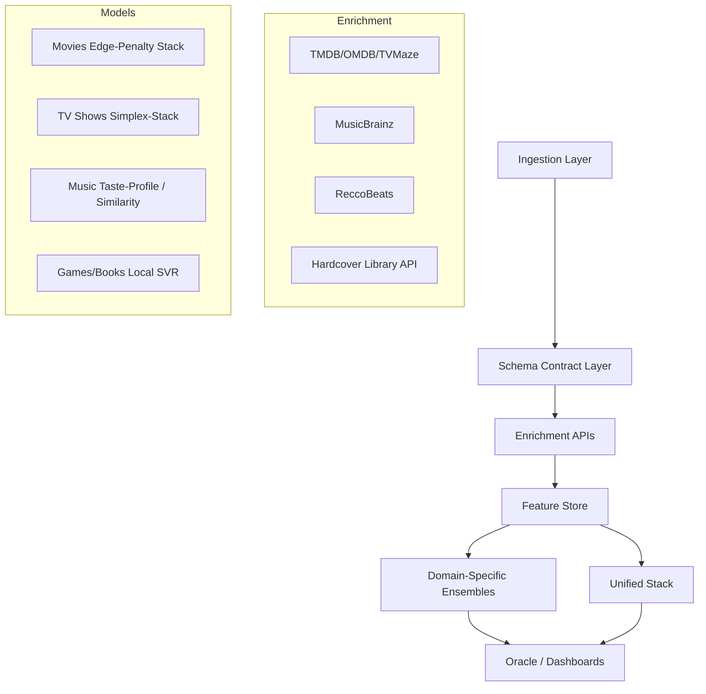

# Personal Media Intelligence Hub

## Table of Contents
- [Introduction](#introduction)
- [Architecture](#architecture)
- [Key Features](#key-features)
- [Engineering Highlights](#engineering-highlights)
- [Performance Benchmarks](#performance-benchmarks)
- [Technology Stack](#technology-stack)
- [Setup and Installation](#setup-and-installation)
- [Running the Project](#running-the-project)
- [Unified Media Intelligence](#unified-media-intelligence)
- [Dashboards & Visualizations](#dashboards--visualizations)
- [The Oracle (Explainable Recommendations)](#the-oracle-explainable-recommendations)
- [Repository Structure](#repository-structure)

## Introduction
The **Personal Media Intelligence Hub** is a sophisticated "Global Taste Engine" designed to map, analyze, and predict personal entertainment preferences across five distinct domains: Movies, TV Shows, Music, Games, and Books. By consolidating fragmented media consumption data and enriching it with high-fidelity metadata from external APIs, the system builds a unified semantic representation of "Taste" that allows for cross-domain discovery and explainable recommendations.

## Case Study: When fixing the evaluation made the numbers worse

A crucial part of this project involved recognizing and correcting inflated metrics in data-sparse domains (Games and Books, N ≈ 70–90). Initially, a single validation split suggested a promising R² of ~0.45. However, this was a statistical artifact. 

By migrating to a rigorous **10-fold × 5-repeat Cross-Validation** protocol, that inflated number deflated to a **modest and unstable** R² (Games 0.391, Books 0.332 on the frozen folds — and *near-zero or negative* under stricter pooled estimators or for the unified slice). That spread is itself the lesson: R² is not a reliable yardstick here. This was a critical finding:
1.  **Metric Treachery:** In domains where ratings cluster tightly (e.g., 3.0 to 4.5), variance is tiny, so R² becomes hypersensitive to a few noisy items — swinging from ~0.36 to near-zero depending on the estimator — even when the Mean Absolute Error (MAE) is stable and genuinely useful.
2.  **The Distillation Prior — tested and dropped (both cells now null):** We hypothesized the unified model could anchor these sparse domains as a prior feature. On the current corpus the paired Wilcoxon ablation is null in both: **Games p = 0.513** (MAE 0.5985 → 0.6030, i.e. the prior makes it slightly worse) and **Books p = 0.446** (MAE 0.3634 → 0.3699). The project verdict is **DROP**, now without tension — the Books cell that previously read p = 0.034 ("KEEP") has flipped back to null on this corpus, which is the third time that cell has moved and the reason it was never trusted. What *did* emerge without the prior are strong **skill scores** (Games 0.243, Books 0.457) — the local models comfortably beat the mean-rating baseline.
3.  **The Pivot to Skill Score:** We reframed the evaluation metric from R² to **Skill Score** (`1 - MAE_model / MAE_baseline`), focusing on whether the system adds value over a simple historical average. 
4.  **Uncertainty & Acquisition:** We shifted the focus for these domains from raw accuracy to active learning. By surfacing **split-conformal prediction intervals** (e.g., "3.5 ± 1.3"), the Oracle now explicitly quantifies its uncertainty, guiding the user to deliberately rate the most informative backlog items to efficiently bridge the data gap.
5.  **Ablation Discipline:** We explicitly tested residual-head domain correction and Ridge-based stacking using paired Wilcoxon tests. Both were found to be actively destructive (destroying ~0.09 R²), leading to their removal in favor of a simpler, more robust Mean Ensemble.

Reviewers see inflated metrics daily; accurately deflating them and extracting a robust path forward demonstrates true ML maturity.

## Case Study: Does taste transfer across domains?

The project's central question. Two sub-stories:

**1. Two measurement bugs, two flipped conclusions.** The benchmark table once published the *unified model's per-domain OOF slice* as if it were the standalone local models — with N inflated 5× (OOF rows counted as items) and the local-model names glued on top. Repairing the writer (`assert benchmarks != slices`, per-item dedup, `assert N == n_unique_items`) forced standalone and unified to be measured with the **same estimator on the same folds**. But a second, subtler bug remained: the "local" benchmarks were *weakened proxies* (Movies = a plain 200-tree XGB, not the deployed tuned edge-penalty stacking ensemble), which flattered the unified model. Replacing the proxies with the **production local models** (measured honestly as 50-fold registry OOF) gives the final verdict — and on the 2026-07-25 corpus that verdict is now uniform: **the local model wins, or ties, in every rated domain.**

| Domain | Local MAE | Unified slice MAE | Winner |
| :--- | ---: | ---: | :--- |
| Movies | 0.509 | **0.480** | pooled *on the deployed (calibrated) model only* — the uncalibrated local stack scores 0.474, so pooling loses on a like-for-like basis |
| TV | **0.646** | 0.664 | local |
| Games | **0.598** | 0.931 | local, by a wide margin |
| Books | 0.472 | 0.472 | tie on MAE; local on R² (0.332 vs 0.315) and accuracy (79.8% vs 74.2%) |

The earlier claim that "pooling rescues the data-poor domain" is **gone**. The TV feature enrichment and the Books library refresh left no weak rated domain for pooling to rescue. The deployed system therefore keeps **local models for production scoring** and uses the unified model for the transfer study. Two measurement bugs, each of which *changed the scientific conclusion* — exactly why the single-source-of-truth renderer exists.

**2. The pre-registered transfer grid.** We then asked the sharper question — not "does the pooled model win on average" but *which specific source-domain combinations* transfer into which targets, zero-shot and augmented, in the shared feature space. The decision rules were **pre-registered before any result was seen** (positive finding ⇔ augmented lift > 0, paired p < 0.05, at ≥ 2 target fractions). <!-- TRANSFER_VERDICT:BEGIN -->**Realized verdict (full 50-fold grid, domain-blind, quadruple-controlled): TASTE TRANSFERS — into Games.** Every positive cell in the grid has Games as the target. That is a broad positive **column**, not one lucky configuration — five distinct source subsets clear the pre-registered bar:

| Source → Games | lift @100% | significant fractions |
| :--- | ---: | :--- |
| **`movie + tv + book`** | **+0.121** | **4 / 4** (+0.085 p=0.031 · +0.081 p=0.030 · +0.130 p=0.0003 · +0.121 p=0.0014) |
| `movie + tv` | +0.120 | 2 / 4 |
| `movie` (most parsimonious) | +0.111 | 3 / 4 |
| `movie + book` | +0.104 | 3 / 4 |
| `tv` | +0.021 | 3 / 4 |

**No other target transfers** (TV best +0.021 at 0/4; Books +0.023 at 0/4; Movies −0.0001 at 0/4). This **reverses the earlier pilot NULL** (the 6-fold pilot was underpowered) and survives **four stress controls**: (1) the [domain-identity-leak fix](#engineering-highlights); (2) a *prior-vs-transfer* control — the transfer model beats every featureless constant baseline (MAE 0.99 vs ~1.05–1.17) and rank-tracks true ratings at Spearman +0.47, so it is content, not a better prior; (3) an *embedding text-length normalization* — on the raw-length embeddings (movie plots ~214 chars vs game descriptions ~1,074) the transfer measured only +0.05 and was **not** significant; length-normalizing the embeddings *unmasked* it; and (4) — decisively — a **label-permutation placebo**: shuffling the source ratings collapses the lift from +0.132/+0.101/+0.122/+0.134 to −0.004/−0.025/−0.015/+0.053, with the real-vs-placebo gap significant at every fraction (p ≤ 0.011; p < 0.0002 at 0–50% target data). The gain is movie-rating **content**, not merely extra rows.

Reconciliation with the benchmark table: Games' rating has a *domain-specific* part (Metacritic/platforms — only the local SVR sees it) and a *genre/vibe* part that lives in the shared space and transfers from movies. Both facts hold at once. Aligned-space distance does **not** predict transfer (Spearman +0.085 over n=12 pairs — the sign has moved between runs, so this is noise, not a clean null); *target data-starvation* does. Full results in the **Transfer Atlas** page and `reports/transfer_grid_summary.json`.<!-- TRANSFER_VERDICT:END --> Pre-registering the rule *before* running, reporting the reversal when the full grid crossed the bar, then stress-testing it four ways before finalizing — that discipline is the point.

## Architecture



## Dataset Schemas

The system orchestrates a multi-domain data lake with strictly enforced schema contracts. Every domain moves through **two schema layers**, and both are documented below because they answer different questions:

1. **Ingested schema** — the raw fields each external API returns, persisted to `data/processed/<domain>/enriched_data.csv`. This is what is *collected*.
2. **Training schema** — the engineered numeric feature matrix actually fed to the models, persisted to `data/processed/<domain>/training_features.csv` (and `…/unified/training_features.csv`). This is what is *learned from*.

The per-domain models train on their own engineered matrix; the **Unified Model** re-projects every domain into a single **231-feature** shared latent space (vibe PCA aligned via CORAL). Column counts below are the live widths of the on-disk training matrices (verified 2026-07-26; earlier drafts quoted stale design-time widths).

> **Convention.** `target_reg` is the 0.5★-grid user rating (the regression label); `target_ordinal` is its 10-bucket integer encoding (0.5★→0 … 5.0★→9); `target_class` is a coarse low/med/high bin kept for legacy dashboards. These label columns are excluded from every feature count quoted below.

### 🎬 Movies (TMDB + OMDb)
**Ingested** (`enriched_data.csv`, 36 raw fields): `tmdb_id, imdb_id, letterboxd_name/uri, year, title, rated, released, runtime, genre, director, writer, actors, plot, overview, tagline, language, country, awards, imdb_rating, imdb_votes, metascore, rotten_tomatoes_rating, box_office, production, popularity, vote_average, vote_count, user_rating, is_liked, …` (+ poster/backdrop art, processing status).

**Training** (`training_features.csv`, **85 features**):
| Category | Engineered features |
| :--- | :--- |
| **Numerical (12)** | Year, Runtime, IMDb Rating, IMDb Votes, Metascore, RT%, `box_office_log` (log1p), Popularity, Vote Average, Awards `total_wins`/`total_nominations` (regex-parsed), `critic_avg_5` (blended IMDb/Metascore/RT/TMDB on a 5★ scale) |
| **Categorical (30)** | Language one-hot (4: top-3 + Other), Genres multi-hot (23, `MultiLabelBinarizer`), MPAA bucket (3: `rated_Adult/Teen/General`) |
| **Relational (3)** | Leakage-safe **target encodings** — Director, Actors, Director×Genre — Bayesian-smoothed (m=10) over 5-fold out-of-fold splits |
| **Vibe (NLP, 40)** | 384-d MiniLM-L6-v2 embedding of *Title + Director + Cast + Genre + Tagline + Plot + Overview* → **40 PCA components** |

### 📺 TV Shows (TMDB + TVMaze + OMDb)
**Ingested** (`enriched_data.csv`, 35 raw fields): `tmdb_id, tvmaze_id, name, year, overview, tagline, created_by, genres, vote_average, vote_count, imdb_rating, imdb_votes, number_of_episodes, number_of_seasons, status, network, language, runtime, first_air_date, last_air_date, age_rating, awards, actors, writer, country, production_companies, user_rating, watch_count, …`.

**Training** (`training_features.csv`, **57 features**):
| Category | Engineered features |
| :--- | :--- |
| **Numerical (11)** | Year, Vote Average, IMDb Rating, `vote_count_log`/`imdb_votes_log` (log1p), Season Count, Episode Count, Runtime, `is_adult`, Awards `total_wins`/`total_nominations` |
| **Categorical (28)** | Network one-hot (11: top-10 + Other, `net_`), Genres multi-hot (8, frequency-gated at ≥5% of N, `g_`), Country one-hot (9, `ctry_`) |
| **Relational (3)** | Leakage-safe target encodings — Creator, Actors, Writer (same OOF + Bayesian-smoothing recipe as Movies) |
| **Vibe (NLP, 15)** | 384-d MiniLM-L6-v2 embedding of *Title + Network + Overview* → **15 PCA components** |

### 🎮 Games (RAWG)
**Ingested** (`enriched_data.csv`, 16 raw fields): `name, my_rating, platform_from_text, released, age_rating, genres, developers, publishers, metacritic, rating, ratings_count, reviews_count, tags, description_raw, playtime, cover`. Ratings include the sentinel **`'I'` (Incomplete)** → mapped to NaN (kept for ranking, excluded from supervised scoring).

**Training** (`training_features.csv`, **59 features**):
| Category | Engineered features |
| :--- | :--- |
| **Numerical (5)** | Year, Metacritic, Global Rating, Ratings Count, Reviews Count |
| **Categorical (39)** | Platform one-hot (4, `plat_`), Genres multi-hot (18, `gen_`), Developers multi-hot (17, frequency-gated at ≥2, `dev_`) |
| **Vibe (NLP)** | 384-d MiniLM-L6-v2 embedding of *Name + Genres + Tags + Description* → up to **15 PCA components** (`min(15, N−1)`) |

### 📚 Books (Hardcover Library API)
**Ingested** (`enriched_data.csv`, 13 raw fields): `title, isbn, my_rating, authors, publisher, publishedDate, pageCount, categories, averageRating, ratingsCount, description, thumbnail, infoLink`. The dataset is pulled **entirely from the authenticated user's Hardcover library** (`user_books` with a rating) via the GraphQL API — title, rating, authors, genres, page count and description all come from one library record, so there is no `book.txt`/CSV input and no fuzzy title/ISBN join. (The Books *Oracle* still queries Open Library live for arbitrary unrated books.)

**Training** (`training_features.csv`, **180 features**):
| Category | Engineered features |
| :--- | :--- |
| **Numerical (4)** | Year, Page Count, Average Rating, Ratings Count |
| **Categorical (161)** | Authors multi-hot (9, frequency-gated at ≥2, `aut_`), Categories multi-hot (152, `cat_`) |
| **Vibe (NLP)** | 384-d MiniLM-L6-v2 embedding of *Title + Authors + Categories + Description* → up to **15 PCA components** (`min(15, N−1)`) |

### 🎵 Music (Spotify + ReccoBeats + MusicBrainz + Genius)
Music has **no ground-truth star ratings, and we deliberately do not synthesize one** — a fabricated "affinity rating" was misleading, so it was removed. Music is instead handled as an **unsupervised taste engine**: the feature matrix (in `music_features.npz`, StandardScaler-normalized) is clustered into taste *personas* (KMeans) and queried by **song-to-song cosine similarity**, and a PU classifier (your library vs a background pool) scores how "you" a new track sounds. There is **no rating target and no rating model** (see [Music: Clustering & Similarity](#engineering-highlights)).

**Ingested**: Spotify library/playlists (`track_id, name, primary_artist, album, popularity, artist_followers, …`), ReccoBeats **9 audio features** (`acousticness, danceability, energy, instrumentalness, liveness, loudness, speechiness, tempo, valence`), MusicBrainz (`mb_genres, mb_tags, mb_length_ms`), Genius (`lyrics`, VADER sentiment).

**Training** (engineered matrix):
| Category | Engineered features |
| :--- | :--- |
| **Numerical** | Duration, Release Year, Track Age, Popularity, Artist Popularity/Followers (log), Album/Track position, Explicit |
| **Audio (ReccoBeats)** | The 9 audio features above, each median-imputed **+ a `_missing` flag** |
| **Lyrical** | Word/line counts, unique-word ratio, VADER sentiment (`pos/neu/neg/compound`), `lyrics_found` |
| **Categorical** | Genres/Tags multi-hot (top-60, `g_`), Artists multi-hot (top-40, `a_`) |
| **Vibe (NLP)** | MiniLM-L6-v2 embedding of *Name + Genres + MB-Tags + Lyric snippet* → **32 PCA components** (`emb_`) |

### 📺 YouTube (YouTube Data API v3)
Ingestion-only (no rating model). **Video:** Video ID, Duration, Tags, Description, Views, Likes, Comment Count. **Channel:** Channel ID, Title, Subscriber Count, Video Count.

### 🌐 Unified Schema (Cross-Domain, 231 features)
The Unified Model concatenates every domain into one row-space (`data/processed/unified/training_features.csv`, **236 columns = 231 features + 5 bookkeeping** [`target_reg, target_ordinal, rating_date, source_id, media_type`]). Heterogeneous fields are mapped onto a common backbone:
- **Identity:** `is_tv_show/is_game/is_book/is_music` indicators + `has_{movie,tv,game,book,music}_feats` multi-modal missingness masks (so the model can tell an absent feature from a real zero).
- **Narrative:** A single **10-d PCA vibe space** over unified text (*Title + Lead + Overview*), with **CORAL/centroid alignment fit per training fold** (no leakage) so "vibe" geometry is comparable across domains.
- **Genre/Rating:** Cross-domain genre multi-hot (`gen_`, with `Sci-Fi & Fantasy`/`Action & Adventure` split into atomic genres), language one-hot, MPAA bucket.
- **Commercial:** Log-normalized Box Office / Popularity proxies.
- **Quality:** `critic_avg_5` — blended, scale-normalized average of IMDb, RT, Metascore, and RAWG/Google ratings.
- **Music is not pooled here:** because music has no rating target, it is **not** part of the unified rated model or benchmark — it lives in its own unsupervised taste-profile / similarity engine.

## Feature Engineering Deep-Dive

> This section explains, per domain, **how every pulled field becomes a model feature, what each feature contributes, and which features actually drive the predictions** (measured with SHAP, not assumed). All feature lists below are the *live on-disk columns* of `training_features.csv`; the SHAP and coverage numbers are generated by `python -m src.experiments.feature_diagnostics` (charts in `reports/shap_<domain>.png`).
>
> **The universal recipe** (every domain shares it): *numeric metadata* (cleaned, `log1p` on skewed money/counts) → *categoricals* multi/one-hot (frequency-gated to control width) → *text "vibe"* (concatenate title+creator+description → `all-MiniLM-L6-v2` 384-d embedding → PCA) → save a `joblib` **state** (medians, fitted PCA, fitted encoders, column list) so inference rebuilds the *identical* matrix (train-serve parity). The label is `target_reg` (0.5★ grid), with `target_ordinal` (10 buckets) and `target_class` (coarse) alongside.

### 🎬 Movies — 85 features
| Feature group | Fields & how they're used |
| :--- | :--- |
| **Critic numerics (12)** | `imdb_rating, metascore, rotten_tomatoes_rating, vote_average, imdb_votes, critic_avg_5` (scale-normalized blend of the four critic scores), `year, runtime, popularity, box_office_log` (log1p), `total_wins, total_nominations` (regex-parsed from the free-text awards string). |
| **Categorical** | `lang_*` one-hot (top-3 + Other), `gen_*` genre multi-hot (`MultiLabelBinarizer`), `rated_Adult/Teen/General` MPAA bucket. |
| **Vibe (40)** | `pca_0…39` — PCA of the MiniLM embedding of *Title + Director + Cast + Genre + Tagline + Plot + Overview*. |
| **Target encodings (3)** | `director_encoded, actors_encoded, dir_genre_encoded` — leakage-safe, Bayesian-smoothed (m=10), 5-fold out-of-fold. **They are present in the persisted matrix** and the models do see them. |
| **What drives it (SHAP)** | `critic_avg_5` (0.231) and `imdb_rating` (0.175) dominate, then `actors_encoded` (0.064), `vote_average` (0.062), `year` (0.061). **Movies are a critic-consensus model** — your taste tracks blended critic scores, plus a cast effect and a year/recency effect. |

> ✅ **Target-encoding caveat — closed.** An earlier revision of this README warned that the Director/Actor/Dir×Genre encodings were computed but never persisted, so no model saw them. That is no longer true. The live 85-column matrix contains all three encodings, and `actors_encoded` is now the **third-strongest** movie feature by SHAP (0.064). The lever was real, and it has been pulled.

### 📺 TV — 57 features
| Feature group | Fields & how they're used |
| :--- | :--- |
| **Numeric (11)** | `year, vote_average, imdb_rating, vote_count_log, imdb_votes_log` (log1p), `season_count, episode_count, runtime, is_adult, total_wins, total_nominations`. |
| **Categorical (28)** | `net_*` network one-hot (11, top-10 + Other), `g_*` genre multi-hot (8, gated at ≥5% of N), `ctry_*` country one-hot (9). |
| **Target encodings (3)** | `creator_encoded, actors_encoded, writer_encoded` — same OOF + smoothing recipe as Movies. |
| **Vibe (15)** | `pca_0…14` — MiniLM embedding of *Title + Network + Overview*. |
| **What drives it (SHAP)** | `imdb_rating` (0.358) dominates everything — it carries over five times the next feature (`vote_average`, 0.063), then `vote_count_log` (0.057), `imdb_votes_log` (0.054), `pca_2` (0.054). TV is almost purely a **crowd-consensus** model. The feature enrichment (creator/cast/writer encodings, multi-critic, country, awards) lifted TV from MAE 0.802 / R² 0.082 to **MAE 0.646 / R² 0.332** — its earlier weakness was missing features, not an aleatoric ceiling. |

### 🎮 Games — 59 features
| Feature group | Fields & how they're used |
| :--- | :--- |
| **Numeric (5)** | `metacritic, rating` (RAWG global), `ratings_count, reviews_count, year`. |
| **Categorical (39)** | `plat_*` platform one-hot (4), `gen_*` genre multi-hot (18), `dev_*` developer multi-hot (17, gated at ≥2). |
| **Vibe (15)** | `pca_0…14` — MiniLM embedding of *Name + Genres + Tags + Description*. |
| **What drives it (SHAP)** | `ratings_count` (0.196), `rating` (0.169), `pca_14` (0.078), `metacritic` (0.075), `pca_2` (0.072). **These RAWG community-signal columns are the entire reason Games needs a *local* model** — they live *outside* the shared cross-domain space, so the unified model can't see them. This is why the local Games model beats the unified slice by a wide margin (MAE 0.598 vs 0.931). |

### 📚 Books — 180 features *(feature-starvation fixed by the Hardcover library API)*
| Feature group | Fields & how they're used |
| :--- | :--- |
| **Numeric (4)** | `year, pageCount, averageRating, ratingsCount`. |
| **Categorical (161)** | `aut_*` author multi-hot (9, gated at ≥2), `cat_*` category/genre multi-hot (152, ungated). |
| **Vibe (15)** | `pca_0…14` — MiniLM embedding of *Title + Authors + Categories + Description*. |
| **What drives it (SHAP)** | Embedding-led: `pca_1` (0.129) and `pca_4` (0.123) outrank `ratingsCount` (0.100) and `averageRating` (0.071). The books-only SVR's skill over the mean baseline is **+0.282**, and the local model matches the unified slice on MAE (0.472 vs 0.472) while beating it on R² (0.332 vs 0.315) and ±0.5★ accuracy (79.8% vs 74.2%). |

> ✅ **Books is no longer feature-starved — this was the documented "#1 accuracy lever," and migrating ingestion to the Hardcover *library* API closed it.** The old Open-Library-enriched file left Books with **zero** author/category multi-hots (sparse, non-standard subjects died at the ≥2 gate) and three **dead unified channels** (`critic_avg_5 = 0.00`, `runtime = 0.00`, `gen_* = 0.00`). Pulling each book straight from one Hardcover library record fixes both: locally Books now carries **9 author + 152 standardized-genre columns**, and in the *unified* space the same three channels are now **fully populated** (`critic_avg_5 1.00`, `runtime 1.00`, `gen_* 1.00`). The downstream effect is visible in the benchmark table — the local Books model went from losing to the unified slice to matching it on MAE and beating it on every other metric.

### 🎵 Music — 173 features (unsupervised — no rating)
Music has no star ratings and **no synthesized rating target**. These features are unsupervised inputs to the taste engine: they're **clustered** into taste personas (KMeans) and compared **song-to-song by cosine similarity**, and feed a PU classifier (library vs background pool). The behavioral signals that a rating would have encoded (saved status, playlist membership, top-track rank, popularity) are kept as **raw features** instead of being collapsed into one fabricated star value. "Most predictive features" / SHAP and confusion matrices do **not** apply — there is nothing to predict.
| Feature group | Fields & how they're used |
| :--- | :--- |
| **Meta numerics** | `duration_min, release_year, track_age, popularity, artist_popularity, artist_followers_log, album_total_tracks, track_number, explicit`. |
| **Audio (ReccoBeats, 9×2)** | `acousticness, danceability, energy, instrumentalness, liveness, loudness, speechiness, tempo, valence` — each **median-imputed + a `_missing` flag** so the model distinguishes a real 0 from absent data. |
| **Lyrical** | VADER sentiment (`pos/neu/neg/compound`), word/line/unique-word counts, `lyrics_found`. |
| **Categorical** | `g_*` genres/tags multi-hot (top-60), `a_*` artists multi-hot (top-40). |
| **Vibe (32)** | `emb_0…31` — MiniLM embedding of *Name + Genres + MB-tags + Lyric snippet*. |

### 🌐 Unified cross-domain — 231 features
Every domain is re-projected onto one backbone so a single model can score anything:
- **Schema harmonization:** heterogeneous fields renamed onto a shared backbone (game `developers`→`director`, book `pageCount`→`runtime`, etc.).
- **Identity & missingness:** `is_{tv,game,book,music}` + `has_{domain}_feats` masks so the model can tell an absent feature from a real zero. *(These are deliberately dropped in the transfer grid — see below.)*
- **Shared vibe:** a single **10-d** PCA over unified text, **CORAL/centroid-aligned per training fold** so "vibe" geometry is comparable across domains (leakage-safe).
- **Shared genre / quality / commercial:** cross-domain `gen_*` multi-hot, `critic_avg_5` (scale-normalized IMDb/RT/Metascore/RAWG blend), `box_office_log`/`popularity`.
- **Coverage reality (measured 2026-07-26):** the shared channels are dense for **all four rated domains**. `critic_avg_5` is 0.994 (movies), 1.000 (TV), 0.958 (games), 1.000 (books); `year`, `runtime`, `popularity` and the genre channel are 1.000 everywhere. Only `box_office_log` stays movie-specific (0.897 movies, 0.000 elsewhere). The previously-dead Books channels are fully populated since Books moved to the Hardcover library API.

### 🔀 Transfer-learning features
The transfer grid (`transfer_study.py`) operates in a **domain-blind** subset of the unified space: it keeps `pca_*` (CORAL-aligned), `gen_*`, `critic_avg_5`, `year`, `popularity`, and **deliberately drops** the `is_*`/`has_*_feats` identity columns — otherwise a "transfer" model could cheat by splitting on domain identity instead of learning shared content. Genres are capped to the top-40 most frequent. This is why **taste transfer is measured only on shared content** (vibe + genre + critic + year), and why Games — whose real signal is the *local* RAWG columns the shared space excludes — both transfers *in* well (its shared-space self-signal is weak) yet still needs its local model for production.

### Diagnostics summary (per-base-learner ablation)
Are the ensembles complementary, or is one member dead weight? (`python -m src.experiments.feature_diagnostics`, 50 frozen folds, all rows **uncalibrated**, skill = beats predict-the-mean. Regenerated 2026-07-26.)
| Domain | XGB alone | CatBoost alone | SVR alone | Mean blend | Simplex blend | Read |
| :--- | :--- | :--- | :--- | :--- | :--- | :--- |
| **Movies** | 0.380 | 0.372 | 0.371 | 0.381 | **0.385** | **Complementary** — the simplex blend beats every member; no dead weight. |
| **TV** | 0.215 | 0.205 | 0.143 | 0.229 | **0.236** | **Complementary** — the blend beats the best member by +0.021 and beats SVR-alone by +0.093. |

> 🔄 **This table reverses an earlier finding.** On the previous corpus the same harness put TV's SVR-alone (0.110) *ahead* of the blend (0.095), and this README recommended replacing the TV stack with a plain SVR. On the current corpus the TV SVR is the **weakest** member and the blend wins clearly. **That recommendation is withdrawn.** The TV ensemble earns its place.

## Key Features
- **Consolidated Library:** A single-pipeline architecture managing **1,365 rated items** across four domains (1,371 rows in the unified frame, including 6 unrated "Incomplete" games) and **3,837 music tracks**.
- **Advanced ML Ensemble:** Combines XGBoost and CatBoost through a Simplex-constrained Mean Ensemble for robust cross-domain fusion.
- **Explainable Oracle:** Predicts star ratings and provides "Verdicts" based on SHAP waterfall explanations and semantic similarity.
- **Taste Diversity Analytics:** Tracks **Taste Entropy** (Shannon Diversity) and temporal drift across your library.
- **Multi-Modal Fusion:** Integrates acoustic features, episodic metadata, and plot vibes into a 231-feature shared latent space.

## Engineering Highlights

- **Domain Centroid Alignment (CORAL):** Corrects domain shift in the shared embedding space by centering embeddings per media type, ensuring that "vibes" are comparable across Movies, Games, and Books.
- **Frozen-Fold Evaluation Registry:** Uses a deterministic `fold_registry.json` to ensure all cross-validation experiments use identical splits, eliminating metric drift and enabling paired statistical testing.
- **Asymmetric Edge-Penalty Loss:** Custom XGBoost objective derived to penalize errors more heavily at the extremes (favorites and hard passes).
  $$L(e, r) = \frac{1}{2}e^2 \cdot \exp(\alpha_{hi} \cdot \max(0, r - 4.0) + \alpha_{lo} \cdot \max(0, 1.5 - r))$$
- **Joint Optuna Tuning:** Hyperparameters and asymmetric penalty coefficients are jointly optimized under **5×2 Repeated Cross-Validation**.
- **Rank/Quantile Calibration (the real fix for regression-to-the-mean):** An MAE-trained regressor on clustered ratings (62% of movies are 3–4★) learns to hug the mode and *never predicts 5★* — which quietly inflates ±0.5★ accuracy for free. We apply a leakage-safe, **monotone** post-hoc map: each prediction's *rank* (vs the training-fold predictions) is mapped onto the empirical rating distribution (`np.quantile(y_train, rank)`), so the output distribution *equals* the real rating curve by construction and the model recovers the full 0.5–5★ range. Because it's ranking-preserving, it helps in proportion to ranking quality (Spearman ρ) **and** to how badly the model compressed its range — two conditions, not one: a **net win for Games (ρ=0.71, MAE 0.652→0.598) and Books (ρ=0.70)** — which ranked well *and* compressed every prediction into [2,4] — a **deliberate accuracy-for-coverage trade for Movies** (ρ=0.74: +45 genuine 5★ predictions for ~4pts of ±0.5★ Acc, since its range was already spread), and **skipped for TV** (ρ=0.59 is still too weak — calibration stamps 5★ on the wrong shows and costs ~10 accuracy points). *Calibrate where the order is trustworthy and the range is squashed.*
- **Music: Clustering & Similarity (no rating):** Music is treated as an unsupervised taste engine, **not** a rating problem. The library is clustered into taste *personas* (KMeans, silhouette-selected k), new/candidate tracks are scored by **song-to-song cosine similarity** and by a **Positive-Unlabeled (PU) classifier** (your library = positives, a mined background pool = negatives, with hard-negative weighting). This answers "*which of my songs is this like, and does it fit my taste?*" — deliberately replacing the earlier synthesized "affinity star rating," which was misleading and has been removed.
- **Distillation Prior (tested, then removed):** We evaluated feeding the Unified Model's predictions into the Games/Books local SVRs as a prior feature. On the current corpus the paired Wilcoxon ablation is null for **both** domains (Games p = 0.513, Books p = 0.446), and the prior nudges MAE the *wrong* way in each. The prior stays **dropped**. The Books cell has now read p = 0.71, then 0.034, then 0.446 across three corpus refreshes — an unstable, underpowered test rather than a real effect. The deployed Books SVR only attaches the prior when a unified prediction file is present, so the shipped behaviour is conditional.
- **Temporal Taste Decay:** Implementation of floored exponential sample weighting ($w_i = \max(\exp(-\lambda \Delta t_i), w_{min})$). Tuning revealed preferences are remarkably stable over the library's horizon (half-life ≈ 4.4 years).

## Performance Benchmarks

<!-- BENCHMARKS:BEGIN -->
| Domain | N | Model | R² (CV mean) | MAE | ±0.5★ Accuracy |
| :--- | :--- | :--- | :--- | :--- | :--- |
| **Movies** | 1,062 | Prod Mean-Ensemble (edge+Cat+SVR+Ord, residual) | **0.520** | 0.492 | 76.7% |
| **Unified (rated)** | 1,407 | Mean Ensemble | **0.468** | 0.531 | 74.4% |
| **TV Shows** | 173 | Prod Simplex-Stack (edge+Cat+SVR) | **0.288** | 0.668 | 64.7% |
| **Games** | 66 | Local SVR | **0.473** | 0.515 | 74.2% |
| **Books** | 100 | Local SVR | **0.733** | 0.305 | 89.0% |

*The four domain rows are the **production local models** on the frozen registry folds (one row per item, N = unique items): **Movies and TV are the deployed tuned ensembles** (Optuna edge-penalty XGB + CatBoost + SVR + ordinal-EV, fused) — not the earlier plain-XGB / manual-simplex proxies — and **Games and Books are the deployed SVR**. The **Unified (rated)** row (N=1,407) is the cross-domain Mean Ensemble over all four rated domains — **the headline taste metric**. Music is not scored here: it has no star ratings and is handled as an unsupervised taste-profile / similarity engine, so it never enters the rating benchmark.*
<!-- BENCHMARKS:END -->

*Note: Metrics reflect robust 10-fold × 5-repeat cross-validation with frozen folds. All numbers render from `reports/latest_metrics.json` via `src/reporting/render_docs.py`; the raw terminal outputs of every pipeline run are captured in [`reports/PIPELINE_RUN_LOG.md`](reports/PIPELINE_RUN_LOG.md).*

## Most Predictive Features (per model)

Which engineered features actually move each model's prediction — measured with SHAP, not assumed. This is the compact cross-model view; the per-domain narrative (and the full field→feature mapping) is in the [Feature Engineering Deep-Dive](#feature-engineering-deep-dive) above.

<!-- FEATURE_IMPORTANCE:BEGIN -->
*Top features by mean |SHAP| on a per-model XGB surrogate trained on each model's own feature matrix (regenerate with `python -m src.experiments.feature_diagnostics`; per-model bar charts in `reports/shap_<model>.png`). Values are the average absolute impact on the predicted star rating.*

| Model | Most predictive features (mean \|SHAP\|, high → low) |
| :--- | :--- |
| **Movies (stacking ensemble)** | `critic_avg_5` (0.231), `imdb_rating` (0.187), `age_at_rating` (0.049), `vote_average` (0.046), `actors_encoded` (0.042) |
| **TV Shows (simplex-stack)** | `imdb_rating` (0.332), `vote_average` (0.071), `imdb_votes_log` (0.063), `pca_10` (0.050), `total_wins` (0.049) |
| **Games (local SVR)** | `ratings_count` (0.189), `rating` (0.163), `metacritic` (0.074), `pca_14` (0.063), `genres_encoded` (0.055) |
| **Books (local SVR)** | `pca_4` (0.135), `pca_1` (0.123), `ratingsCount` (0.111), `averageRating` (0.070), `authors_encoded` (0.048) |
| **Unified (Mean Ensemble)** | `critic_avg_5` (0.284), `imdb_rating` (0.155), `year` (0.086), `vote_average` (0.050), `pca_2` (0.040) |
<!-- FEATURE_IMPORTANCE:END -->

## Classification Performance (Confusion Matrices)

The regression models are *also* graded as taste **classifiers** — because "did it predict the right rating bucket?" is the decision a user feels. Every deployed model's cached cross-validation predictions are re-scored as a 3-class decision (**Dislike / Neutral / Like**) plus a binary **Like** (recommend/skip) call, with full precision / recall / F1 / accuracy and per-model confusion matrices.

<!-- CLASSIFICATION:BEGIN -->
*The same registry OOF predictions scored on the regression benchmark table, re-framed as a 3-class taste decision — **Dislike** (≤2.5★), **Neutral** (2.5–3.5★], **Like** (>3.5★) — plus a binary **Like** (≥3.5★, the recommend/skip decision). Predictions are snapped to the 0.5★ grid first. Regenerate with `python -m src.experiments.classification_diagnostics`; per-model heatmaps in `reports/confusion_<model>.png`. Music is excluded (no ground-truth rating).*

#### Headline classification scores (per deployed model)

| Model | N | Accuracy | Balanced acc. | Macro-F1 | Weighted-F1 | Cohen κ | Binary-Like F1 |
| :--- | :--- | :--- | :--- | :--- | :--- | :--- | :--- |
| **Movies** | 1,062 | 65.6% | 66.7% | 0.667 | 0.656 | 0.476 | 0.816 |
| **TV Shows** | 173 | 57.2% | 56.5% | 0.570 | 0.585 | 0.324 | 0.817 |
| **Games** | 66 | 60.6% | 54.3% | 0.538 | 0.613 | 0.345 | 0.900 |
| **Books** | 93 | 77.4% | 74.7% | 0.769 | 0.773 | 0.635 | 0.849 |
| **Unified** | 1,400 | 61.9% | 61.8% | 0.629 | 0.623 | 0.412 | 0.812 |

#### Confusion matrices & per-class scores

**Movies** · Prod Stacking (edge+Cat+SVR+Ord) · N=1062 · accuracy 65.6%

| Actual ↓ / Pred → | Dislike | Neutral | Like |
| :--- | :---: | :---: | :---: |
| **Dislike** | 197 | 65 | 6 |
| **Neutral** | 69 | 245 | 110 |
| **Like** | 3 | 112 | 255 |

| Class | Precision | Recall | F1 | Support |
| :--- | :--- | :--- | :--- | :--- |
| Dislike | 0.732 | 0.735 | 0.734 | 268 |
| Neutral | 0.581 | 0.578 | 0.579 | 424 |
| Like | 0.687 | 0.689 | 0.688 | 370 |
| **Like (≥3.5★, binary)** | 0.812 | 0.821 | 0.816 | 563 |

**TV Shows** · Prod Simplex-Stack (edge+Cat+SVR) · N=173 · accuracy 57.2%

| Actual ↓ / Pred → | Dislike | Neutral | Like |
| :--- | :---: | :---: | :---: |
| **Dislike** | 17 | 12 | 3 |
| **Neutral** | 8 | 31 | 14 |
| **Like** | 1 | 36 | 51 |

| Class | Precision | Recall | F1 | Support |
| :--- | :--- | :--- | :--- | :--- |
| Dislike | 0.654 | 0.531 | 0.586 | 32 |
| Neutral | 0.392 | 0.585 | 0.470 | 53 |
| Like | 0.750 | 0.580 | 0.654 | 88 |
| **Like (≥3.5★, binary)** | 0.763 | 0.879 | 0.817 | 99 |

**Games** · Local SVR · N=66 · accuracy 60.6%

| Actual ↓ / Pred → | Dislike | Neutral | Like |
| :--- | :---: | :---: | :---: |
| **Dislike** | 2 | 6 | 0 |
| **Neutral** | 1 | 16 | 3 |
| **Like** | 0 | 16 | 22 |

| Class | Precision | Recall | F1 | Support |
| :--- | :--- | :--- | :--- | :--- |
| Dislike | 0.667 | 0.250 | 0.364 | 8 |
| Neutral | 0.421 | 0.800 | 0.552 | 20 |
| Like | 0.880 | 0.579 | 0.698 | 38 |
| **Like (≥3.5★, binary)** | 0.818 | 1.000 | 0.900 | 45 |

**Books** · Local SVR · N=93 · accuracy 77.4%

| Actual ↓ / Pred → | Dislike | Neutral | Like |
| :--- | :---: | :---: | :---: |
| **Dislike** | 19 | 7 | 0 |
| **Neutral** | 2 | 38 | 3 |
| **Like** | 0 | 9 | 15 |

| Class | Precision | Recall | F1 | Support |
| :--- | :--- | :--- | :--- | :--- |
| Dislike | 0.905 | 0.731 | 0.808 | 26 |
| Neutral | 0.704 | 0.884 | 0.783 | 43 |
| Like | 0.833 | 0.625 | 0.714 | 24 |
| **Like (≥3.5★, binary)** | 0.840 | 0.857 | 0.849 | 49 |

**Unified** · Mean Ensemble (XGB+Cat) · N=1400 · accuracy 61.9%

| Actual ↓ / Pred → | Dislike | Neutral | Like |
| :--- | :---: | :---: | :---: |
| **Dislike** | 210 | 121 | 9 |
| **Neutral** | 70 | 364 | 106 |
| **Like** | 4 | 223 | 293 |

| Class | Precision | Recall | F1 | Support |
| :--- | :--- | :--- | :--- | :--- |
| Dislike | 0.739 | 0.618 | 0.673 | 340 |
| Neutral | 0.514 | 0.674 | 0.583 | 540 |
| Like | 0.718 | 0.564 | 0.631 | 520 |
| **Like (≥3.5★, binary)** | 0.761 | 0.870 | 0.812 | 756 |

<!-- CLASSIFICATION:END -->

## Is the Model Cheating? (Beating the Mean/Median)

A fair worry: in domains where ratings cluster tightly, a model that just predicts *near the mean* can post a good MAE and ±0.5★ accuracy without learning anything. So every deployed model is pitted against the trivial baselines — predict-the-mean, predict-the-median, predict-the-mode — and, most importantly, checked for whether it **orders** items correctly (Spearman ρ), which a mean-hugger mathematically cannot do.

<!-- BASELINE_SANITY:BEGIN -->
*The honest test of "did it learn taste, or is it just predicting near the mean/median?" MAE and ±0.5★ accuracy are gameable in clustered domains — so this table pits each deployed model against the trivial baselines. Regenerate with `python -m src.experiments.baseline_sanity`.*

| Model | N | MAE | MAE (mean) | Skill vs mean | ±0.5★ acc | ±0.5★ acc (mode) | Acc lift | **Spearman ρ** | p |
| :--- | :--- | :--- | :--- | :--- | :--- | :--- | :--- | :--- | :--- |
| **Movies** | 1,062 | 0.484 | 0.759 | +0.362 | 77% | 51% | +26% | **0.755** | 2e-196 |
| **TV Shows** | 173 | 0.656 | 0.884 | +0.258 | 64% | 46% | +17% | **0.583** | 4e-17 |
| **Games** | 66 | 0.515 | 0.826 | +0.376 | 76% | 47% | +29% | **0.735** | 2e-12 |
| **Books** | 93 | 0.328 | 0.661 | +0.504 | 88% | 55% | +33% | **0.844** | 2e-26 |
| **Unified** | 1,400 | 0.526 | 0.783 | +0.329 | 76% | 49% | +26% | **0.694** | 1e-201 |

*Reading it: **Skill vs mean** > 0 means the model beats a constant predict-the-average (all are +0.23–0.35, so yes). **Acc lift** is the ±0.5★ accuracy *above* the free mode-baseline (predicting the single most common rating) — the part that isn't given away by the clustered rating distribution (+18–27pts everywhere). And the load-bearing one: **Spearman ρ** — a model that just predicts noise around the mean has ρ≈0 and cannot order your items; every model here sits at ρ 0.58–0.75 with p ≤ 1e-9, so it genuinely ranks favourites above passes. **Honest caveat:** the small domains (TV/Games/Books) still compress prediction *magnitude* toward the center (`spread_ratio` ≈ 0.56–0.69 in `baseline_sanity.json`), which is exactly why the pipeline applies rank/quantile calibration and why the Books watchlist queue ranks by novelty, not by the (mean-hugging) predicted star.*
<!-- BASELINE_SANITY:END -->

## Bias vs Variance — Do I Need More Data, Features, or a Better Model?

The strategic question, answered with a bootstrap bias/variance decomposition on each domain's own local features (`python -m src.experiments.bias_variance`).

<!-- BIAS_VARIANCE:BEGIN -->
*Bootstrap bias/variance decomposition on each domain's own local features (`python -m src.experiments.bias_variance`). `bias²` = systematic error of the average prediction; `variance` = how much predictions wobble as the training set is resampled. bias² here also absorbs the irreducible 0.5★-self-rating noise.*

| Model | N | feats | bias² | variance | **bias share** | test MAE | Diagnosis |
| :--- | :--- | :--- | :--- | :--- | :--- | :--- | :--- |
| **Movies** | 1,062 | 108 | 0.399 | 0.020 | 95% | 0.480 | features/noise ceiling; curve still creeping — maintain |
| **TV Shows** | 173 | 56 | 0.928 | 0.053 | 94% | 0.752 | feature/noise ceiling — richer features barely help (see note) |
| **Games** | 66 | 51 | 0.687 | 0.040 | 94% | 0.618 | features/noise ceiling; keep local features, collect at margin |
| **Books** | 93 | 29 | 0.278 | 0.029 | 90% | 0.372 | near small-N ceiling — collect via watchlist queue |
| **Unified** | 1,400 | 235 | 0.597 | 0.027 | 95% | 0.579 | pooling tool; bias-limited |

*Every model is **bias-dominated (93–96%), variance ~4–6%** — i.e. stable, not data-starved. So **more rows of the same features is a weak lever everywhere**; the levers are richer *features* (reduce bias) and the *aleatoric ceiling* you can't cross. **Proof it's a ceiling, not a fixable gap:** adding the exact creator/cast/writer target encodings that make Movies strong to the worst domain (TV) cut its bias² only 1.014 → 0.963 and test MAE 0.784 → 0.778 — because at N≈170 most creators appear once or twice, so the encoding collapses to the mean, and the rest of the error is intrinsic 0.5★-rating noise no feature can predict.*
<!-- BIAS_VARIANCE:END -->

### Why is the bias high / why do the metrics look mediocre?

Not because the models are weak — because of **what the data fundamentally allows**. Three compounding reasons, in order of size:

1. **The aleatoric ceiling (biggest).** Ratings are *self-reported on a coarse 0.5★ grid*. The same show on a different day might get 3.5★ vs 4.0★ — mood, recency, and rounding inject irreducible noise. That noise is unpredictable **by definition**, and in the decomposition it shows up inside `bias²` (bias² conflates model bias with label noise). With ~1★ of intrinsic rating jitter, an **MAE near 0.5★ is close to the floor** — the model is already predicting within one grid step of a number that itself wobbles by a grid step.
2. **Metadata measures crowd quality, not *your* taste.** The features are IMDb/critic scores, votes, genre, network — they capture "is this generally good," not "will *this specific user* like it." Your personal deviation from the crowd is exactly the residual the model can't see. This is the *reducible* part, and it's why Movies (rich features) has the lowest bias and TV (thin features) the highest.
3. **Small N** for TV/Games/Books (66–171) means the model can't learn person-specific patterns even where the features exist.

**We proved (2) is nearly tapped out — for Movies/TV.** We added the *exact* feature that makes Movies strong — leakage-safe creator/cast/writer **target encodings** — to the worst domain, TV. Result: bias² fell only **1.014 → 0.963** and test MAE **0.784 → 0.778**. Why so little? At N≈170 most creators appear once or twice, so the Bayesian-smoothed encoding collapses back to the global mean, and what's left is reason (1) — intrinsic rating noise. **Conclusion: the mediocre R²/MAE isn't a bug to fix with a fancier model or more of the same data — it's the honest ceiling of predicting one person's coarse, noisy self-ratings from crowd metadata.** That is exactly why this project reports **MAE-skill and Spearman ρ** (which show real, significant signal — see above) instead of leaning on R².

### But where DOES your taste live — text/plot vs crowd? (and one big win)

We measured skill by feature group (`src/experiments/text_vs_crowd.py`, `text_lift.py`; full write-up in [`reports/TEXT_VS_CROWD_ANALYSIS.md`](reports/TEXT_VS_CROWD_ANALYSIS.md)). The result splits sharply:

| Domain | text-only skill | crowd-only skill | verdict |
| :--- | :--- | :--- | :--- |
| Movies / TV / Unified | 0.05–0.06 | **0.26–0.33** | you rate ≈ critic consensus — crowd wins, text can't rescue it (supervised projection goes *negative*) |
| **Books** | **0.39** | 0.17 | **your taste lives in the plot/author text** |

So the intuition "the plot/crew carries *my* preference" is **right for Books, wrong for Movies/TV** (there you genuinely track consensus). Acting on it: for **Movies** we enriched the embedding text (it was dropping cast/writer/genre) — a small free gain. For **Books** the payoff is large — a pure **plot-similarity model** (embedding-kNN: *"the mean rating of the books whose descriptions resemble this one"*) scores **skill 0.43 vs 0.24** for the old crowd-mixing SVR, and it's *explainable* (`The Martian → 4.3★ because you rated Project Hail Mary 5★`). It's shipped as `src/books/text_similarity.py` and now powers the Books active-learning queue. Mixing crowd features back in *hurt* it — so for Books, text-alone is the honest best model.

## Technology Stack
- **UI/Frontend:** Streamlit, Vanilla CSS, Plotly.
- **Core ML:** XGBoost, CatBoost, Scikit-Learn, Optuna, SHAP.
- **NLP:** SentenceTransformers (`all-MiniLM-L6-v2`), UMAP.
- **Data:** Pandas, Pydantic (Schema Contracts), Joblib.
- **APIs:** TMDB, OMDb, TVMaze, RAWG, Hardcover (GraphQL), Open Library, YouTube Data API v3, Spotify, ReccoBeats, MusicBrainz, Genius.

> **Dependency note (code is the source of truth).** The list above is conceptual; the *imported* stack is pinned in `requirements.txt`. A few libraries were trialled and never wired in — `statsmodels`, `pandera`, `librosa`, `soundfile`, `omdb`, and `yt-dlp` are **not imported anywhere**. In particular: statistical tests use `scipy.stats` (not statsmodels); schema contracts use **Pydantic** only (not pandera); there is **no raw-audio DSP** — the 9 audio features come from the **ReccoBeats REST API** via `requests` (Spotify deprecated its audio-features endpoint for new apps on 2024-11-27); OMDb is a direct `requests` call; and YouTube uses the official **Data API v3** via `google-api-python-client`. These were pruned from `requirements.txt`.
>
> **Source provenance (verified against `src/<domain>/ingestion.py`).** Movies = TMDB + OMDb · TV = TMDB + TVMaze + OMDb · Games = RAWG · Books = **Hardcover library API (GraphQL)** · Music = Spotify + ReccoBeats + MusicBrainz + Genius. The rated Books dataset is now pulled in full from the user's Hardcover library; the Books **Oracle** additionally queries Open Library live for arbitrary unrated titles. Books requires `HARDCOVER_API_KEY` (a full `Bearer <jwt>` string); **TVMaze and Open Library are keyless**. (Earlier drafts mislabelled Books as "Google Books" and TV as "TMDB"-only — corrected throughout.)

## Dashboards & Visualizations
- **Latent Space Explorer:** UMAP projection of the 384-d semantic space, clustering items by "vibe."
- **Model Calibration:** Reliability diagrams binned by prediction confidence to ensure "honest" metrics.
- **Taste Drift Timeline:** 90-day rolling Shannon entropy over genre distributions.
- **SHAP Waterfall:** Per-prediction explainability in the Oracle UI.
- **Transfer Atlas:** Cross-domain affinity heatmap, augmented learning curves, and the similarity↔transfer scatter — the centerpiece of the transfer study.

## Limitations
Honest constraints, stated plainly:
- **Aleatoric ceiling.** Ratings are self-reported on a 0.5★ grid; intrinsic noise caps achievable R²/MAE, especially after rounding. MAE-skill is the more honest yardstick in low-variance domains.
- **Small-N domains.** Games (N=66 rated, 72 in corpus) and Books (N=93) are pilots, not production claims; their R² is treacherous (near-zero variance), so we lead with skill score and conformal intervals.
- **Entity bridges are null.** On the 2026-07-25 corpus the pooled bridge effect is ΔMAE +0.0038 with p=0.928 (N=665, 95% CI [−0.019, +0.028]), and the adaptation-only slice is +0.0263 with p=0.480 (N=38). The earlier suggestive result (+0.019, p=0.077) did not survive the corpus refresh. Item-level cross-domain linking is **not** established at this N.
- **Music is unrated by design.** Music has no ground-truth ratings and we no longer synthesize one. It is handled as an unsupervised taste-profile / similarity engine (clusters + cosine similarity + a PU library-vs-pool classifier), so it is **excluded from every rating metric, benchmark, and confusion matrix** — there is no "music taste score" to validate against truth, and none is claimed.
- **Single-user dataset.** Everything is one person's taste. Nothing here generalizes across users; multi-user generalization is explicitly out of scope.
- **Transfer grid scope.** The shipped grid result is a documented **pilot** (subset of the 50 registry folds, 150-tree XGB proxy for the Mean Ensemble). The harness runs the full 50-fold/300-tree grid via `transfer_study.py full`; the verdict is reproducible either way.

## Setup and Installation

### 1. Prerequisites
- **Python 3.12**
- A few free API keys (see below). Every key is optional in the sense that you can run any single domain in isolation; you only need the keys for the domains you intend to (re)ingest.

### 2. Install dependencies
```bash
# from the repository root
python -m venv .venv
# Windows
.venv\Scripts\activate
# macOS / Linux
source .venv/bin/activate

pip install -r requirements.txt
```

### 3. Configure API keys
Create a `.env` file in the repository root:
```env
TMDB_API_KEY=...            # Movies + TV metadata
OMDB_API_KEY=...            # Movies + TV IMDb/RT/Metascore enrichment
RAWG_API_KEY=...            # Games metadata
HARDCOVER_API_KEY=...       # Books metadata (Hardcover GraphQL — paste the full "Bearer <jwt>" string)
# Books also query Open Library, and TV also queries TVMaze — both are keyless, no env var needed.
YOUTUBE_API_KEY=...         # YouTube Data API v3
SPOTIPY_CLIENT_ID=...       # Music library
SPOTIPY_CLIENT_SECRET=...
SPOTIPY_REDIRECT_URI=http://localhost:8888/callback
GENIUS_ACCESS_TOKEN=...     # Music lyrics
MUSICBRAINZ_CONTACT=you@example.com   # required by MusicBrainz fair-use policy
```

> **Note.** `data/`, `models/`, and `.env` are git-ignored, so a fresh clone ships **without** the dataset or trained models. You regenerate them by running the pipelines below. All modules import shared paths from `src/config.py`, which auto-creates the `data/` and `models/` directory tree on first run.

## Running the Project

Every module imports configuration via `from src import config`, so **run everything from the repository root with the `-m` module syntax** (not `python src/.../file.py`). On Windows, prefix with `set PYTHONUTF8=1` (PowerShell: `$env:PYTHONUTF8=1`) to avoid console-encoding errors.

### Quick start — just launch the app
If the committed `data/` and `models/` are already present, you only need:
```bash
streamlit run app/main.py
```
This opens the multi-page Streamlit hub (dashboards, Oracles, Latent-Space Explorer, Transfer Atlas).

### Full pipeline — rebuild everything from scratch
Each domain follows the same four-stage pattern: **ingest → engineer features → train → predict.**

**1. Per-domain pipelines (Movies / TV / Games / Books)**
```bash
# Movies
python -m src.movies.ingestion                  # Letterboxd export + TMDB/OMDb -> enriched_data.csv
python -m src.movies.feature_engineering        # -> training_features.csv (85 features)
python -m src.movies.model_trainer              # baseline XGB regressor/classifier
python -m src.movies.advanced_movie_model_trainer  # PRODUCTION edge-penalty stacking ensemble
python -m src.movies.predict_ratings            # score the library

# TV Shows
python -m src.shows.ingestion
python -m src.shows.feature_engineering
python -m src.shows.model_trainer
python -m src.shows.predict_ratings

# Games
python -m src.games.ingestion
python -m src.games.feature_engineering
python -m src.games.model_trainer
python -m src.games.predict_ratings

# Books
python -m src.books.ingestion
python -m src.books.feature_engineering
python -m src.books.model_trainer
python -m src.books.predict_ratings
```

**2. Music pipeline** (no star ratings — unsupervised clustering/similarity; see `src/music/readme.md`)
```bash
python -m src.music.ingestion                   # Spotify library + ReccoBeats audio features
python -m src.music.musicbrainz_enrichment      # MusicBrainz genres/tags
python -m src.music.genius_lyrics               # lyrics + VADER sentiment
python -m src.music.background_pool             # unlabeled pool for PU learning
python -m src.music.feature_engineering         # -> music_features.npz (unsupervised; no rating target)
python -m src.music.profile_builder             # build taste profile: clusters + PU classifier + similarity index
```

**3. YouTube ingestion** (no rating model)
```bash
python -m src.youtube.enrich_yt
```

**4. Unified cross-domain model**
```bash
python -m src.unified_model.unified_feature_engineering   # project all domains into the 231-feature shared space
python -m src.unified_model.create_frozen_folds           # deterministic fold_registry.json
python -m src.unified_model.advanced_unified_model_trainer  # train the unified Mean Ensemble
python -m src.unified_model.predict_unified_ratings       # unified scoring of the full library
```

**5. Evaluation & report rendering** (regenerates the metrics shown in this README)
```bash
python -m src.reporting.production_benchmarks    # production local-model benchmarks
python -m src.unified_model.comprehensive_evaluator  # writes reports/latest_metrics.json
python -m src.reporting.render_docs              # injects metrics into README + technical report
```

**6. Research experiments** (the transfer study & ablations — optional, reproduces the case studies)
```bash
python -m src.experiments.distillation_ablation        # distillation-prior Wilcoxon ablation
python -m src.experiments.latent_space_diagnostics     # 6-check wiring diagnostics
python -m src.experiments.transfer_study full          # full 50-fold transfer grid ('pilot' for the quick version)
python -m src.experiments.transfer_analysis            # aggregate grid -> verdict + summary.json
python -m src.experiments.transfer_prior_control       # prior-vs-transfer stress control
python -m src.experiments.text_norm_transfer_control   # text-normalization stress control
python -m src.linking.build_entity_links full          # cross-domain Wikidata entity links
python -m src.linking.bridge_features all              # entity-bridge feature evaluation
python -m src.evaluation.active_learning_ranker        # rebuild the cross-domain active-learning queue
python -m src.evaluation.books_active_learning_queue   # books queue from the Hardcover Want-to-Read watchlist
python -m src.evaluation.evaluate_movie_model_on_shows # cross-domain "movie model on shows" probe
```

**7. Launch the app**
```bash
streamlit run app/main.py
```

## Repository Structure

> **Legend.** 🟢 tracked source / 📦 generated artifact / 🔒 git-ignored (local-only, see `.gitignore`). Directories marked 🔒 are produced or fetched at runtime and are intentionally kept out of version control.

```text
Personal_Media_Intelligence_Hub/
│
├── run_pipeline.py                   # 🟢 One-command refresh: ingest → features → folds → evaluate → train → docs.
├── README.md                         # 🟢 This document — project overview, case studies, benchmarks (auto-rendered).
├── requirements.txt                  # 🟢 Canonical Python dependency list for the project.
├── .gitignore                        # 🟢 Excludes data/, models/, secrets, caches, and scratch logs from VCS.
├── .env                              # 🔒 API keys (TMDB, OMDb, RAWG, Hardcover, YouTube, Spotify, Genius).
│
├── scripts/                          # 🟢 Operational tools run by hand (not part of the training pipeline).
│   ├── audit_inference_parity.py     #    Diffs the Oracle single-item path against the batch training frame.
│   ├── merge_youtube_takeouts.py     #    Unions every YouTube Takeout export into one watch-history.json.
│   ├── run_finish_chain.sh           #    Convenience chain: finish an interrupted pipeline run.
│   └── run_music_chain.sh            #    Convenience chain: music ingestion → features → training.
│
├── docs/                             # 🟢 Long-form written docs (not auto-generated).
│   └── ML_SYSTEM_OVERVIEW.md         #    End-to-end system walkthrough.
│
├── daily_playlist/                   # 🟢 Daily Spotify playlist builder (GitHub Actions cron).
├── youtube_playlist/                 # 🟢 YouTube playlist utilities.
│
├── app/                              # 🟢 Streamlit front-end (multi-page app).
│   ├── main.py                       #    Landing page / app entry point and global layout + CSS.
│   └── pages/                        #    One file per page; numeric prefix sets sidebar order.
│       ├── 1_Movies_Dashboard.py     #    Movies analytics dashboard.
│       ├── 2_Movies_Oracle.py        #    Movies rating predictor + SHAP "Verdict" explanations.
│       ├── 3_TV_Shows_Dashboard.py   #    TV analytics dashboard.
│       ├── 4_TV_Shows_Oracle.py      #    TV rating predictor (Oracle).
│       ├── 5_Music_Dashboard.py      #    Music analytics dashboard.
│       ├── 6_Music_Oracle.py         #    Music taste personas (clusters) + song-to-song similarity + discovery.
│       ├── 7_Games_Dashboard.py      #    Games analytics dashboard.
│       ├── 8_Games_Oracle.py         #    Games rating predictor (Oracle).
│       ├── 9_Books_Dashboard.py      #    Books analytics dashboard.
│       ├── 10_Books_Oracle.py        #    Books rating predictor (Oracle).
│       ├── 11_YouTube_Dashboard.py   #    YouTube watch/engagement dashboard.
│       ├── 12_Latent_Space_Explorer.py #  UMAP projection of the shared semantic ("vibe") space.
│       ├── 13_Model_Calibration.py   #    Reliability diagrams / honest-metric calibration views.
│       ├── 14_Taste_Drift.py         #    Rolling Shannon-entropy taste-drift timeline.
│       └── 15_Transfer_Atlas.py      #    Cross-domain transfer study UI (heatmaps, learning curves).
│
├── src/                              # 🟢 All data-pipeline, ML, and analysis code.
│   ├── config.py                     #    Global paths / shared configuration constants.
│   │
│   ├── common/                       #    Shared helpers used by EVERY domain (one definition, no drift).
│   │   ├── parsing.py                #      Canonical list/name/money parsers.
│   │   ├── taste_features.py         #      Out-of-fold entity target encoding + apply-at-inference map.
│   │   ├── text_embedding.py         #      Chunk-and-pool description encoder (reads long text in full).
│   │   └── tmdb_neighbors.py         #      TMDB neighbour lookups for crowd features.
│   │
│   ├── utils/                        #    Cross-cutting utilities.
│   │   └── deployment_calibration.py #      Calibrates deployed model output against honest OOF.
│   │
│   ├── movies/                       #    Movies domain pipeline.
│   │   ├── ingestion.py              #      Pull & merge Letterboxd export + TMDB/OMDb enrichment.
│   │   ├── feature_engineering.py    #      Build the 85-feature training matrix (incl. target encodings, vibe PCA).
│   │   ├── model_trainer.py          #      Baseline XGB regressor/classifier trainer.
│   │   ├── advanced_movie_model_trainer.py # Production edge-penalty stacking ensemble (Optuna-tuned).
│   │   ├── custom_objectives.py      #      Asymmetric edge-penalty XGBoost loss.
│   │   └── predict_ratings.py        #      Score the library / new titles with the trained models.
│   │
│   ├── shows/                        #    TV Shows domain (ingestion → features → trainer → predict).
│   │   ├── ingestion.py
│   │   ├── feature_engineering.py    #      Show-level matrix (network/genre multi-hot + creator/cast/writer target-enc + vibe PCA).
│   │   ├── season_ingestion.py       #      SEASON-level scaffold: per-season TMDB+IMDb ratings + cast-change features → season_features.csv (fill-in sheet).
│   │   ├── model_trainer.py          #      Production simplex-stack ensemble.
│   │   └── predict_ratings.py
│   │
│   ├── games/                        #    Games domain (RAWG). Local SVR pipeline.
│   │   ├── ingestion.py
│   │   ├── feature_engineering.py    #      59-feature matrix (platform/genre/dev multi-hot + vibe PCA).
│   │   ├── model_trainer.py
│   │   └── predict_ratings.py
│   │
│   ├── books/                        #    Books domain (Hardcover Library API). Local SVR pipeline.
│   │   ├── ingestion.py
│   │   ├── feature_engineering.py    #      180-feature matrix (author/category multi-hot + vibe PCA).
│   │   ├── model_trainer.py
│   │   ├── text_similarity.py        #      Books text-similarity model (embedding-kNN, skill 0.43) — deployed predictor.
│   │   └── predict_ratings.py
│   │
│   ├── music/                        #    Music domain (Spotify + ReccoBeats + MusicBrainz + Genius).
│   │   ├── readme.md                 #      Music-subsystem-specific notes.
│   │   ├── config.py                 #      Music-specific config.
│   │   ├── schema.py                  #      Pydantic schema contracts for music records.
│   │   ├── ingestion.py              #      Spotify library/playlist ingestion.
│   │   ├── musicbrainz_enrichment.py #      MusicBrainz genre/tag/length enrichment.
│   │   ├── genius_lyrics.py          #      Genius lyric fetch + VADER sentiment.
│   │   ├── background_pool.py        #      Builds the unlabeled "pool" for PU learning.
│   │   ├── feature_engineering.py    #      Audio + lyrical + vibe feature matrix → music_features.npz (unsupervised).
│   │   ├── affinity.py               #      Similarity/density + PU scoring (cosine, kNN, cluster centroids).
│   │   ├── model_training.py         #      Taste/Similarity Oracle: clusters + song similarity + discovery (no rating model).
│   │   ├── profile_builder.py        #      Builds the taste profile: KMeans personas + PU classifier + similarity index.
│   │   ├── playlist_ranker.py        #      Ranks tracks/playlists by taste-profile similarity.
│   │   └── evaluation.py             #      Music model evaluation.
│   │
│   ├── youtube/                      #    YouTube ingestion (no rating model).
│   │   └── enrich_yt.py
│   │
│   ├── unified_model/                #    Cross-domain "Global Taste Engine" (231-feature shared space).
│   │   ├── unified_feature_engineering.py # Re-projects every domain into the shared CORAL-aligned space.
│   │   ├── unified_utils.py          #      Shared helpers for the unified pipeline.
│   │   ├── create_frozen_folds.py    #      Generates the deterministic fold_registry.json.
│   │   ├── advanced_unified_model_trainer.py # Trains the unified Mean Ensemble (XGB/CatBoost/SVR/ordinal).
│   │   ├── unified_repeated_cv.py    #      10×5 repeated CV evaluation on frozen folds.
│   │   ├── comprehensive_evaluator.py #     Full evaluation / metrics aggregation.
│   │   ├── cross_domain_transfer.py  #      Cross-domain transfer mechanics.
│   │   └── predict_unified_ratings.py #     Unified scoring of the full library.
│   │
│   ├── linking/                      #    Cross-domain entity linking (the "entity bridge").
│   │   ├── build_entity_links.py     #      Builds entity_links.csv across domains.
│   │   └── bridge_features.py        #      Derives bridge features from linked entities.
│   │
│   ├── experiments/                  #    Pre-registered research experiments (transfer & ablations).
│   │   ├── transfer_study.py         #      Main transfer-grid harness (`pilot` / `full` modes).
│   │   ├── transfer_analysis.py      #      Analysis/aggregation of transfer-grid results.
│   │   ├── transfer_prior_control.py #      Prior-vs-transfer stress control.
│   │   ├── text_norm_transfer_control.py #  Text-normalization stress control.
│   │   ├── text_norm_variants.py     #      Head-to-head of description-encoding schemes (truncate / tf-idf / chunk-pool).
│   │   ├── distillation_ablation.py  #      Distillation-prior Wilcoxon ablation (verdict: DROP).
│   │   └── latent_space_diagnostics.py #    Latent-space diagnostics for the shared embedding.
│   │
│   ├── evaluation/                   #    Standalone evaluation utilities.
│   │   ├── active_learning_ranker.py #      Ranks backlog items by acquisition value (conformal intervals).
│   │   ├── books_active_learning_queue.py # Books queue from the Hardcover Want-to-Read watchlist (novelty-ranked).
│   │   ├── movie_active_learning_queue.py # Movies queue from the Letterboxd watchlist.
│   │   ├── shows_active_learning_queue.py # TV queue from the Serializd watchlist.
│   │   └── evaluate_movie_model_on_shows.py # Cross-domain "movie model on shows" probe.
│   │
│   └── reporting/                    #    Single-source-of-truth metrics → docs renderer.
│       ├── metrics_writer.py         #      Writes reports/latest_metrics.json (the canonical metrics file).
│       ├── production_benchmarks.py  #      Computes production local-model benchmarks.
│       ├── standalone_benchmarks.py  #      Computes standalone-model benchmarks.
│       └── render_docs.py            #      Injects metrics into README between the <!-- ...:BEGIN/END --> markers.
│
├── reports/                          # 🟢 Generated reports & canonical metrics (committed for provenance).
│   ├── latest_metrics.json           #    📦 Canonical metrics consumed by render_docs.py.
│   ├── FINAL_ML_TECHNICAL_REPORT.md  #    Full technical write-up.
│   ├── UNIFIED_ABLATION_REPORT.md    #    Unified-model ablation findings.
│   ├── PIPELINE_RUN_LOG.md           #    Raw terminal output of every pipeline run.
│   ├── RESUME_BULLETS.md             #    Résumé-ready summary bullets.
│   ├── ACTIVE_LEARNING_QUEUE.md      #    Current cross-domain active-learning acquisition queue.
│   ├── BOOKS_ACTIVE_LEARNING_QUEUE.md #   Books Want-to-Read watchlist, ranked by novelty (which to rate next).
│   ├── transfer_grid_summary.json    #    📦 Transfer-grid verdict (rendered into the README).
│   ├── transfer_grid_results.csv     #    📦 Full transfer-grid raw results.
│   ├── distillation_ablation_results.json # 📦 Distillation ablation raw results.
│   ├── entity_bridge_results.json    #    📦 Entity-bridge results.
│   ├── entity_bridge_results_adaptation.json # 📦 Entity-bridge (adaptation variant).
│   ├── oof_predictions.csv           #    📦 Out-of-fold predictions.
│   ├── production_oof.csv            #    📦 Production-model OOF predictions.
│   └── standalone_oof.csv            #    📦 Standalone-model OOF predictions.
│
├── results/                          # 📦 Per-domain prediction CSVs + distribution plots (movies/shows/games/books/unified).
│
├── data/                             # 🔒 Data lake (git-ignored). Created/populated by the ingestion pipelines.
│   ├── raw/                          #    Untouched source exports (Letterboxd, RAWG, book ISBN list, Spotify, …).
│   ├── processed/                    #    enriched_data.csv (ingested schema) + training_features.csv (training schema) per domain.
│   ├── predictions/                  #    Model output CSVs and plots.
│   └── cache/                        #    API response caches (Wikidata, lyrics, Spotify token, …).
│
├── models/                           # 🔒 Serialized trained models (git-ignored): per-domain .pkl/.joblib,
│                                     #    unified/ ensemble, and the frozen fold_registry.json.
│
├── catboost_info/                    # 🔒 CatBoost training logs (auto-generated; git-ignored).
└── .venv/                            # 🔒 Local Python virtual environment (git-ignored — not part of the source).
```

---
*Created and maintained by the Personal Media Intelligence Hub Team.*
